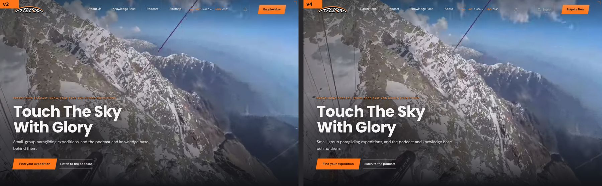
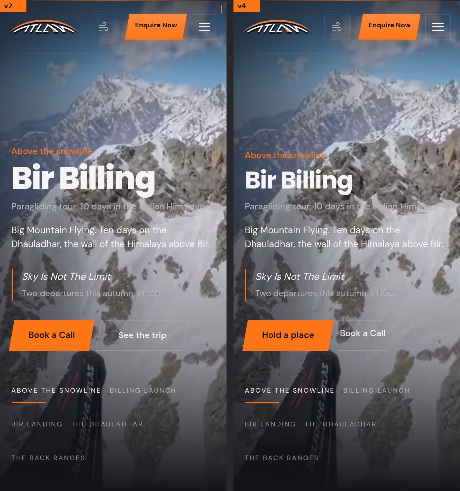
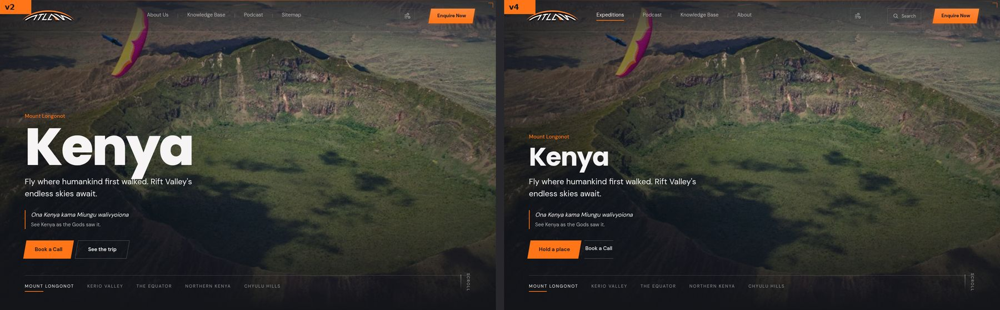
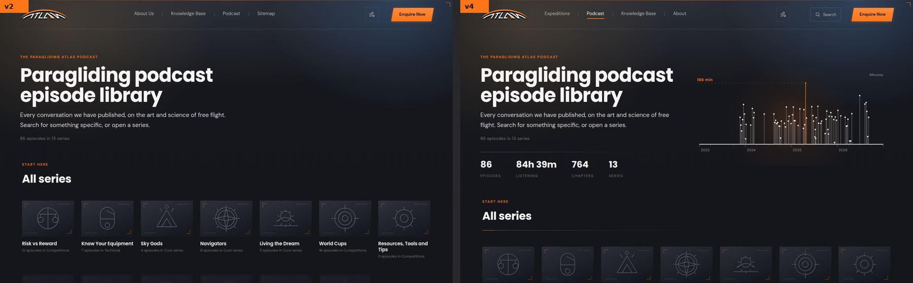
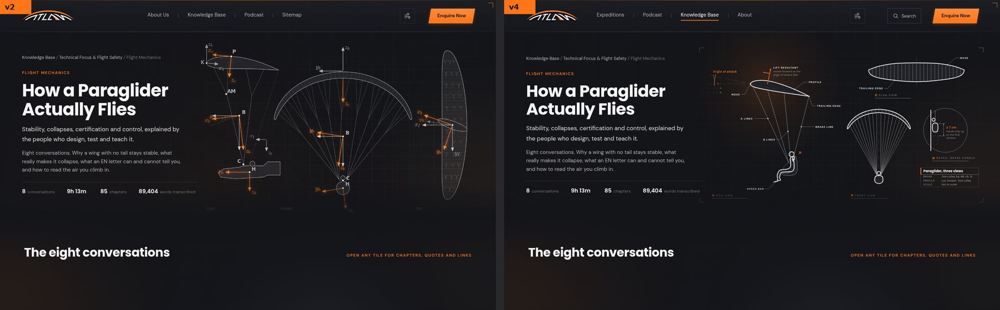
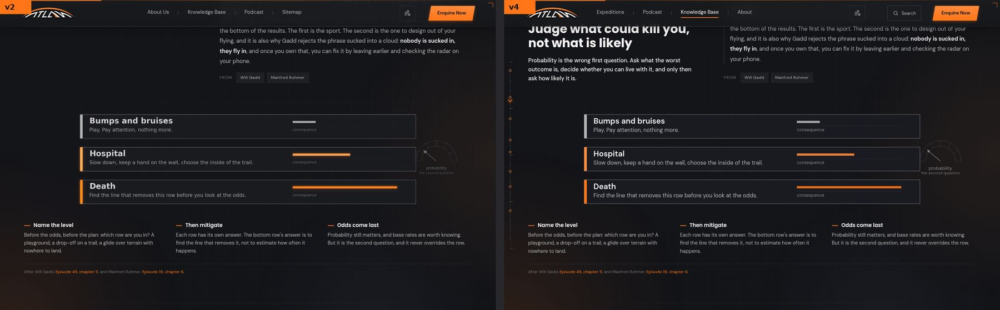
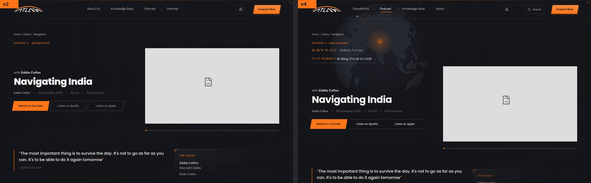
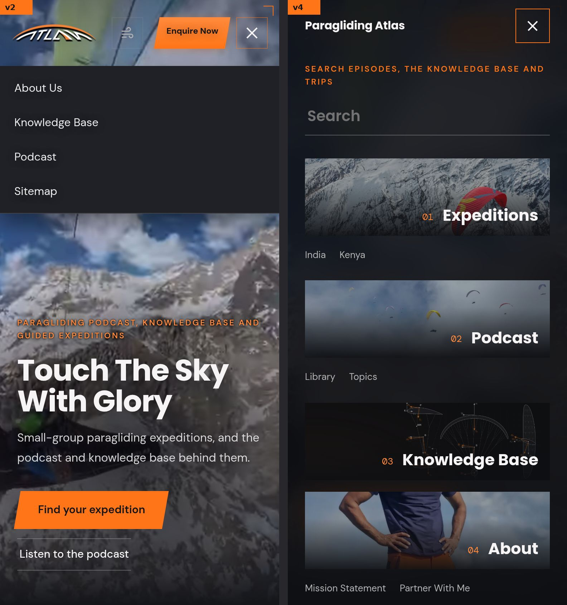

# v4: report of the autonomous build (from 26 Sep 2026)

The brief is `docs/v4-plan.md`. v4 lives in `prototypes/v4/` (hidden,
noindex), previewed at https://paraglidingatlas.com/prototypes/v4/. v2 and
the live site are not changed. v4's rules: `docs/v4-design-rules.md`.

## In short
v4 is ready to look at: https://paraglidingatlas.com/prototypes/v4/ (hidden,
noindex). Steps 0 to 8 of the plan are done, each pushed after every gate
passed. Nothing live and nothing in `prototypes/v2/` changed; `rss-feed.js`
untouched; no switch-over made.

- **One grammar**: three title sizes and one weight, one section head, one
  chip, one button pair, the Arial fix.
- **India and Kenya as fly-throughs**: about 800 words on first read (from
  2,734 and 2,179 measured), every word kept in folds, a trust strip from the
  terms, "Hold a place" on each departure.
- **Signature moments**: the library as a flight log, episodes opening on a
  globe turned to their place, topic logs, cards that open into the page, an
  altimeter, a footage breather, an instrument font for numbers.
- **Navigation**: Expeditions / Podcast / Knowledge Base / About, a
  full-screen menu with photos and one search over 179 pages, a next step at
  the end of every page, bridges between the show and the trips.
- **Speed**: no page heavier than in v2 (India -379 KB, Kenya -160 KB).
- **Drawings**: all 57 knowledge base figures redrawn with the kit, the
  three-view, dials, contours, ridge and icons in the kit's line.

## Before and after
v2 on the left, v4 on the right (`tools/v4_before_after.py`, JPG in
`docs/v4-shots/`, 1.0 MB in all). The video frames are grey where YouTube
is blocked on the build machine.

| | |
|---|---|
| Home |  |
| India on a phone |  |
| Kenya |  |
| Library (the flight log) |  |
| Flight Mechanics (the three-view) |  |
| A knowledge base figure |  |
| An episode (the globe) |  |
| The menu on a phone |  |

## Progress
A check-in reads this table to know where to resume: the first row not
marked done is the next step.

| Step | State | Commit | Gates |
|---|---|---|---|
| 0. Setup: v4 copy, `--site`, v2 byte-identical | done | c649f29 | v4 check 182 pages 0 FAIL; switch v4 180 pages 0 FAIL; audit 0 FAIL; smoke 172 / 0 FAIL; v2 rerun byte-identical |
| 1. Basics: the grammar | done | b0310c7 | all gates PASS (v4 182 pages 0 FAIL, switch 0 FAIL, smoke 0 FAIL, v2 untouched) |
| 2. Drawing kit and the three-view | done (redraws go ahead: step 7) | 63d6a5e | all gates PASS (v4 183 pages 0 FAIL) |
| 3. India, then Kenya | done | edf7a3f | all gates PASS (v4 183 pages 0 FAIL, parity kept on both trips) |
| 4. Signature moments | done (the menu with step 5, KB figures with step 7) | 5be88a9 | all gates PASS (v4 184 pages 0 FAIL) |
| 5. Navigation and wayfinding | done | d5546f5 | all gates PASS (v4 184 pages 0 FAIL) |
| 6. Speed | done | 84258b8 | all gates PASS (v4 184 pages 0 FAIL; switch 0 FAIL after it learnt the deferred image attributes) |
| 7. The remaining redraws | done (poster frame: see notes) | 3ab0e89 | all gates PASS (v4 184 pages 0 FAIL; smoke 0 FAIL on its rerun) |
| 8. The report | done | 8f43896 | all gates PASS (v4 184 pages 0 FAIL, smoke 0 FAIL first run) |
| 9. Series tiles: Gold line, option B for all 13 (owner, 1 Oct) | done | 9b4eac4 | all gates PASS (v4 191 pages 0 FAIL) |
| 10. Stress test of v4 and fixes (docs/v4-stress-test.md) | done: 29 fixed, 3 partly, 16 open (listed there) | 6a40bc9, a117e46, and VP-4 with step 12 | all gates PASS (v4 191 pages 0 FAIL, smoke 0 FAIL) |
| 11. The home page's opening: the ground in the Gold line, a climb, the ground dropping away on scroll (tools/v4_opening.py) | done | 960b890 | all gates PASS |
| 12. The Gold line on the topics (each tile's conversations over time, tools/v4_topics.py) and on the instrument icons | done | 9f3d165 | all gates PASS |
| 13. Trip galleries as a fly-through, option A of three (owner, 1 Oct): India and Kenya, tools/v4_flythrough.py | done | see git log | all gates PASS |
| 14. Trip route sections: zoom from orbit with the route over it (owner: "C with A route overlay"). Kenya: six sites, line diagram by the page's legs; India: Bir's coordinate, the page's schematic as the route. tools/v4_tripmap.py | done | see git log | all gates PASS |
| 15. The 404 as "lost the lift" (owner: B, then "change it with A"): a Gold line vario sinking at -4.04, the barogram falling, the four doors under it. tools/v4_404_options.py --install a | done | see git log | all gates PASS |
| 16. "Tell me why", stage 1 of 3 (owner): ask anything, answered with the guests' own words from 8,904 transcript passages in 78 episodes, searched on the reader's device, each linked to its chapter. Stage 2 (written answers) needs an Anthropic API key and a small server: see Needs the owner. tools/v4_tellmewhy.py, samples/tell-me-why.html | done (sample) | see git log | all gates PASS |
| 17. The app on the phone (owner, 3 Oct: option 1): installable, readable offline. tools/v4_pwa.py | done | 2b191bb | all gates PASS |
| 18. Catch up with the live work of 2 and 3 Oct (owner, 3 Oct: "ok go"): the glass globe on the homepage (scripts load as it nears the screen), the series' Gold line mark in every episode header (v4 keeps its own header globe and chapter timeline, which already do what the live map box and timeline do), the night-sky sitemap. tools/v4_catchup.py | done | see git log | all gates PASS (v4 198 pages 0 FAIL, smoke 177 / 0 FAIL) |
| 19. Page transitions: going back from an episode, the player shrinks into the card that opened it (only a card on screen); pages inside v4 are prerendered while the pointer rests on their link (speculation rules, not on Save-Data, not the enquiry form), so they open at once. v2-immersive.js 6b, 6c | done | see git log | all gates PASS |
| 20. Listening mode on episode pages (src/v4-listen.js, loaded on first use; a button under the player, or #listen): one screen with the player, a dial of the chapters around the header globe that turns to the chapter playing, the series' Gold line drawing drawing itself as the episode goes, the transcript lit line by line and kept in view (paused while the reader scrolls, with "Back to the voice"). Time from the YouTube embed's own messages or the audio element; Space, the arrows and Esc work; reduced motion keeps every state, nothing turns | done | see git log | all gates PASS |
| 21. Immersion to the max (owner, 4 Oct): the owner's footage as film strips on four knowledge base pages and behind the Mission, Enquire and homepage Why bands (tools/v4_footage.py); footage drifts in as it scrolls past; the episode's own picture glows behind its player and the listening screen; hero pictures, footage and the episode globe shift with the pointer or a phone's tilt; the podcast breather's clip now plays (it never did) | done | see git log | all gates PASS |
| 22. The award pass (owner, 4 Oct: items 1, 3, 4, 5, 6 and 9 of the review): a quiet header; the phone header; orange caps labels only in page headers; one motion language; a calm knowledge base landing (the door off, a Gold line climb); About and Podcast with their own openings. tools/v4_award.py, src/v2.css "THE AWARD PASS" | done | see git log | all gates PASS |
| 23. The visual build list (owner, 5 Oct: "visually improving how the site looks, go ahead"): a visual review by page group, every finding checked by a skeptic (48 kept of 48), merged into 32 items and all built; then a before/after regression review. src/v2.css "THE VISUAL BUILD LIST", tools/v4_award.py, tools/v4_tripmap.py, tools/v4_painted.py | done | 93aa11d and see git log | all gates PASS |
| 24. The RSS feed section redesign, ten options (owner, 5 Oct: "give me 10 protos to choose from"): samples/rss-options.html, each one the live feed's own row markup from rss-feed.js with the seven newest episodes, styled only (rss-feed.js unchanged): Ledger, Cover grid, Feature and list, Waveform, Flight log, Timeline, Record shelf, Editorial, Docked player, Portholes. The owner liked 10 and asked for five more like it, "a bit futuristic and immersive and responsive": 11 Instrument ring, 12 Cabin light, 13 Window seat, 14 Fuselage, 15 Night flight (these also need a few lines of script for the pointer, the scroll and the progress ring, meant for v2-immersive.js, never rss-feed.js). The owner then chose 15, Night flight, with 11's progress ring around the cover art, play and pause on the art (no button beside it) and a ticker with the show's name in the open player: built into v4's podcast page (src/v2.css "LIVE FROM THE FEED", replacing the earlier feed styles; the ring's progress copied from the bar rss-feed.js already draws, src/v2-immersive.js), and shown on the samples page as 16 with v4's own rules. rss-feed.js untouched. Then five variations on it (owner, 6 Oct: "make 5 more"), 17 to 21 on the samples page: Constellation, Radar, Northern lights, Vario, Cockpit glass, each a short addition on top of the built rules. tools/v4_rss_options.py | done | see git log | all gates PASS |
| 25. The owner's photographs on the knowledge base and episode pages (owner, 9 Oct; the footage left those pages on 8 Oct): a placement plan from three surveys, a planner and a skeptic who measured the pages (fourteen problems found and folded in): docs/v4-photo-plan.md | waiting on the photos (the Terabox link is blocked here) | see git log | docs only |
| 26. The speed record attempt page (owner, 17 Oct: "a page for the WR attempt ... professional and elegant so that sponsors find it interesting"): record-attempt.html, prototype-only until the owner's go. The target and the owner's best as an instrument readout over Kerio Valley; the out-and-return course drawn to scale, 100 or 200 km, flown as it comes into view, with the time at the mark and at 36 km/h; the marks to beat; why Kerio Valley; the plan to the window (18 Jan to 12 Feb 2027, with the two Kenya departures); the audience; three partnership tiers and what partners get before, during and after. Every fact sourced on the page; the unknowns read [to supply] or [to confirm]. tools/v4_record.py | done (prototype) | see git log | all gates PASS |
| 27. The record page, redesigned (owner, 17 Oct: "very robotic, too much text, difficult to navigate, make it stunning", then "add elements which Awwwards-worthy websites use"): three directions built in full (record-a.html cinematic story, record-b.html instrument panel, record-c.html luxury editorial), judged by a sponsor, a UX and Awwwards juror, and the site's editor (23.1, 22.6, 21.1), the winner built into record-attempt.html with the best of the other two: masked kinetic title, the 35.94 and about 36 counting up, the course pinned and flown with the scroll (100 or 200 km, the clocks running), Kerio Valley seen through its letters, the window as a strip moved sideways by the scroll with the 26-day bar, a ticker that moves only with the scroll, a ring cursor and magnetic buttons on a mouse, still film grain, a labelled chapter bar with a Partner button always in reach; about 365 words. Reduced motion and no JavaScript show the finished page. The three options stay as prototype-only pages. tools/v4_record.py, tools/v4_record_a.py, _b.py, _c.py | done (prototype) | see git log | all gates PASS |
| 28. The record page's backgrounds (owner, 18 to 19 Oct: "the background looks quite bland ... be creative, and use something from online as well if needed"; no stock photos, no other pilots): the page is one record day over Kerio Valley as it scrolls. Pre-dawn under the real stars and Milky Way at the opening, morning gold with rising thermals behind the marks, the course flown over form lines traced from the Kenya page's own terrain, a deep blue midday with a cloud street over Kerio Valley, the warm afternoon, the orange dusk on a drawn Elgeyo escarpment, and night stars over the close. The sun and stars follow their real paths for 6 Feb 2027 at 0.72N 35.65E. Colours from the design tokens, every text kept at 4.5:1; motion only with the scroll; reduced motion and no JavaScript get the same day as a still gradient. Online: star positions from the npm package d3-celestial 0.7.35 (BSD-3-Clause; XHIP, Anderson and Francis 2012), credited in the tool and in the page. Built by a designer, reviewed by an art director and a rules and speed engineer, then fixed. Page HTML 20.9 to 44.2 KB gzipped; images (60 KB in all) load as they come near. tools/v4_record.py, img/record/ | done (prototype) | see git log | all gates PASS |
| 29. The record page, less but better (owner, 19 Oct, with a screenshot: "the animations give a cheap rip-off feeling rather than a premium one, along with the graphics"; he circled the flat grey clouds and the hard seam where the Kerio photograph begins): an art director and a motion director audited every frame; cut the three cloud layers, the drawn hills, ridge and acacias, the sun's disc, the thermals, the ticker, every count-up, the ring cursor and magnetic buttons, the outlined numerals and the giant km count, the photograph inside the letters, the sideways strip and the word-by-word reveals; refined the Kerio seam (the photograph now takes the colour of the sky behind it), one easing curve, motion with weight (an eased glide that stops when settled), typography and real photographs as the graphics. Judged blind against the previous version by a creative director and an engineer: the new one preferred by both. Smoother than before (the shell's unused per-frame --v2-gust write is skipped on this page; removing it from v2-immersive.js would help every page). Facts and markers unchanged. tools/v4_record.py | done (prototype) | see git log | all gates PASS |
| 30. From the record page to the whole site, first two (owner, 19 Oct: "ok"): every page scrolls more smoothly (v2-immersive.js no longer writes the unused --v2-gust to <html> on every scroll frame, which restyled the whole page; nothing read it); the podcast's Night flight feed no longer moves on its own (the twinkling stars, drifting aurora, edge sweep, level meter and ticker loops are gone, as the motion rule and the record page's lesson ask; the look, the progress ring and a still 'Now playing' line stay), and its last raw colours became tokens. rss-feed.js untouched. | done | see git log | all gates PASS |
| 31. Expeditions gets its own page (owner, 19 Oct: "the expeditions standalone tab ... is just an off copy of leftover material at the homepage, I want it a bit different", then "use the same Awwwards rule" and "go crazy with your imagination"): expeditions.html. Three directions built in full (expeditions-a, -b and -c.html, prototype-only), judged, and the winner (C) built with the best of the other two: "Choose Your Sky", Kenya and India side by side with the split following the pointer; the map flown with the scroll from the world to India, Kenya, Kazakhstan and Peru (Natural Earth outlines, public domain; WebGL 2 where there is a real graphics card, drawn in SVG otherwise), each place's own photograph rising out of the map; the year drawn to scale from Oct 2026 to Nov 2027 with each departure on it; "Still Choosing?" over the Last light photograph. Every fact from the trip pages and the home page (Kazakhstan and Peru as the home page gives them: planned, with Register interest); about 330 words. Phones, reduced motion and no JavaScript get a still, stacked page. The header's Expeditions tab, the full-screen menu, the app's Trips shortcut and the search now lead here (they led to the home page's destinations section); the home page section stays. Note for later passes: a full rerun of tools/v4_pass.py rewrites the knowledge base drawings in long path syntax, so it must be followed by tools/v4_ux.py (or the nav change made on its own, as here). tools/v4_expeditions.py, tools/v4_expeditions_a.py, _b.py, _c.py, tools/v4_pass.py, tools/v4_pwa.py, tools/v4_search.py (prototype-only pages now stay out of the search). It is the first page v4 adds to the site rather than replaces, so the switch learnt about new pages: tools/v2_site.py NEW_PAGES; the switch writes such a page at the root, indexable, and gives it its sitemap.xml line (dated by its last commit); the dry run holds it to its own title, description, canonical, Open Graph and structured data instead of a live twin's. The site audit, run on the switched site, now also reads the tokens defined in assets/v4/v2.css, which every switched page loads | done | see git log | all gates PASS |
| 32. One script rebuilds v4 (found 19 Oct while wiring Expeditions): the deploy draft for the switch-over ran only part of the v4 chain and would have published India and Kenya without their fly-through gallery, route map and usability pass, and the knowledge base drawings uncompacted. tools/v4_build.py runs every v4 generator and pass in the order that reproduces the committed v4 byte for byte; proven on a clean checkout (./build.sh, then the script: prototypes/v4 unchanged, a second run unchanged, v2 untouched, the switch dry run 0 FAIL). docs/v4-deploy-workflow.yml now runs it. Along the way: the Navigators map reads its Natural Earth outlines from tools/data/naturalearth_lowres.shp (the copy in the geopandas 0.14.4 wheel, its hash checked against PyPI; public domain) instead of downloading them at build time, and no longer falls back quietly to other outlines; v2_localize passes over prototype-only pages as v2_check does. Built by a workflow (two mappers, a builder, a verifier in a fresh copy each round, three rounds); then its guard on the generator-owned pages was made to ignore ?v= changes, which the live build makes whenever a linked file changes and which would otherwise have stopped a deploy, and the proof rerun. Before the switch-over: a new episode still stops the build (see The switch-over below). tools/v4_build.py, tools/kbfig/nav_land.py, tools/v4_expert.py, tools/v2_localize.py | done | see git log | all gates PASS |
| 33. India, less but better (owner, 19 Oct: the record page's pass carried to the trip pages, one page at a time): the hero one plate with the footage, four big facts over the old row's other four, the fly-through kept as the one moment (a settle per step, no slow zoom, words held at the foot that leave before the next arrive), seamless photographs, the route a schematic flown with a weighted glide, the gallery the owner's pinned fly-through again on a wide screen (one photograph at a time at full brightness, dissolves eased by the same loop, one caption at a time, the count in it, the marks and the skip link) and a column of clean full-width plates on a phone, opening on the back ranges and closing on Last light, the chapter bar with a hairline under the chapter being read, one curve, finished by default. See India, less but better, below (Third review: the gallery). tools/v4_trip_calm.py, src/v4-calm.css, src/v4-calm.js (loaded by India alone), tools/v4_min.py (writes them) | done | see git log | all gates PASS |
| 34. Partners, less but better (owner, 20 Oct: the record page's pass carried to the sponsor funnel, with his three ideas; then a fix round the same day): the opening holds still and dissolves into the page on eased shades; the four audience figures stand big and still under it (no count-up), 100,000+ at least 2.5rem clear of 130+ and on one line at every width, with an "About these numbers" no fold under the figures yet (a blind judge read one that sourced two of the four as hedging; it returns with the owner's source for the 100,000+ streams and the 10+ years), the labels in small capitals again; the episodes in two still rows the visitor swipes; the band in the air still, straight under the episodes, out of the dark and back into it; the record attempt after it, type only, in the record page's own words, with one line of what a partner gets (Title Partner: Your mark on kit and on camera) and room above the flight line, shown only while the record page is part of the site (a v4:needs mark the switch understands); the flight line kept as the one moment, eased with weight and drawn whole by default; the four formats as the pushed page's editorial list again, without its arrows, sliding hover and outlined numerals, with one quiet "Start a conversation"; the portrait as clear as pushed; every numeral in the display face, none in mono; the enquiry over the pushed page's blurred photograph again, without its orange corner marks, the footer close behind it; one curve, tokens only. See Partners, less but better, below. tools/v4_partners.py, tools/v2_site.py (needs), tools/v2_switch.py, tools/v4_search.py, tools/v4_build.py | done | see git log | all gates PASS |
| 35. The sitemap's night sky from real stars (owner's queue, 20 Oct, item 1; the motion asked for by the owner the same day): the live sitemap-sky.js is untouched; the v4 page loads a copy written from it by the tool, v4-sitemap-sky.js, with only its background field changed: in place of the seeded random dots, the 356 real stars to magnitude 4.6 about Sirius (RA 95, Dec -25, looking up, stereographic; d3-celestial 0.7.35 data/stars.6.json, XHIP, BSD-3-Clause notice at the head of the file, credit comment in the page), sized and lit by magnitude in --white and drawn in depth (the brighter, the nearer): the field zooms in slowly and back out (about 80 s each way, the nearer stars further), follows the camera's pan and zoom at a fraction of its pace and leans towards the mouse pointer, eased; with reduced motion it is drawn once and moves only with the camera. The shooting star and the episode stars' twinkle are the live script's and page's own, kept at the owner's word. The episode stars and the series constellations are the data as before. tools/v4_sitemap_sky.py, tools/v4_build.py | done | see git log | all gates PASS |
| 36. The awwwards-direction polish, podcast first (owner, 20 Oct: the pass that stilled the home page was turned down and reverted; motion is kept and added to, never taken away): the opening's three figures (100,000+, 136, 80+) solid and large in the display face on one row at every width, in place of thin outlined numerals; and three moments driven by the scroll alone: the guest names behind the opening slide sideways in rows (alternate rows the other way, each at its own pace) as the opening scrolls away; the pull quote lights up word by word, dim to white in reading order; the globe turns with the scroll while in view (at most 6 degrees a frame), the live globe.js untouched (the page's own loader lets the page note the globe's projection just before globe.js loads). Reduced motion and no JavaScript show the page as it was. One page-only <style> and <script> between <!--v4p:polish--> marks. Library (roadmap step 2): the opening's chart arrives once and settles (bars grow from the baseline, the dots settle, the longest's marker and guide draw) and drifts up more slowly than the page as it scrolls away; on a desktop the series tiles lean towards the mouse in 3D with a soft light, gliding back level. Knowledge base (roadmap step 3): on the hub the climb's route stays, dimmer, and a bright trace climbs it with the scroll, a glider at its tip; each level's outlined number fills in orange while the level is mid-screen; each level's episode row glides in (fades in on a phone); on the 18 category pages the opening drawing drifts slower than the page and leans to the mouse on a desktop, and the questions glide open and closed. Knowledge base look (owner, from a side-by-side preview): hub level numbers solid and larger with the altitude in orange; series as larger panels with the question readable; episodes as pictures with their titles under them, grey until hovered as before; category openings with a larger title and, on a wide screen, a larger drawing (one with its own words keeps its size); on tablets and mid-size laptops the drawing draws smaller towards the right, clearing the overlaps of drawing labels and opening text that existed before this pass (measured: none left on any of the 18 pages at 12 widths from 390 to 1920 px); the questions with more room and an answer column 26 px (18 on a phone) clear of the open question's orange edge. Each knowledge base answer as large as its question (owner, 20 Oct: small answers were hard to read): 20.8 px on a desktop, 17.3 px on a phone, colour, weight and face kept, its sources at body size; measured equal on all 18 pages at 1440, 1024 and 390 px, nothing clipped or overflowing. tools/v4_polish.py, tools/v4_build.py | podcast, library and knowledge base done | see git log | all gates PASS |
| 37. One curve across v4 (owner, 20 Oct: step 1 of the awwwards roadmap): every transition on every v4 page moves on the site's own curve, --ease (quick to start, gliding to a stop), in place of the browser's plain ease: 87 in src/v2.css, 11 in src/v4-calm.css and 3 in src/v4-ux.css rewritten, and one rule at the end of src/v2.css brings the transitions set by the live sheets every v4 page also loads (styles.css, destinations.css, never edited) onto it, leaving script-timed transitions, SVG drawings, the listening bar's timed fills and the trips' slow linear zooms as they were. Checked in the browser: every transitioning element on home, podcast and India on the one curve, the transitioned properties and durations unchanged, no errors. tools: src/v2.css, src/v4-calm.css, src/v4-ux.css (rebuilt by tools/v4_build.py) | done | see git log | all gates PASS |
| 38. Folds that glide (owner, 20 Oct: "every time i click read more it opens up without any smoothness"): every fold on a v4 page (Read more, the trip notes, Why fly with us, What you can expect, the trips' questions, the sitemap's series) opens and closes on the site's curve: its height eases from the summary to the whole, measured as laid out so it never overshoots or snaps, over a time that grows with the distance (360 to 820 ms), and what it opens fades up into place. The knowledge base questions keep their own glide. Reduced motion: at once, as before. src/v2-immersive.js part 17 (written by tools/v4_min.py) | done | see git log | all gates PASS |
| 39. Changing series in the library, modern (owner, 20 Oct: the stone portal "is old and doesnt match the design of the sites immersive modern look"): the stone slab that grew from a tile, split at a seam and opened like doors is gone; a change of series now moves the list itself: the episodes on screen lift and fade, the heading blurs out and wipes across to the new series' name, and the new episodes rise into place one after another on the site's curve (by a chip, the address or the back button). A tile gives a small press and the page glides down to the list, already that series, the heading and episodes arriving as it settles. The same arrival for the page numbers (the page glides to the list's top and the new page rises in) and for an address that names a series; arriving from another page with a series in the address ("Read the series", the popup's "In series") opens on the list itself, the page unseen for the instant it takes to put it there (at most 1.2 s), then the heading and episodes arrive: no glide down from the top. Reduced motion: the list changes at once. prototypes/v4/v2-library.js, tools/v4_polish.py (a committed file no build step writes) | done | see git log | all gates PASS |
| 40. The record attempt in the header (owner, 20 Oct: "b9 is final, push it live and connect the page", from twelve mock-ups): the fifth item of every v4 header (205 pages), after About: three short speed streaks in orange before "Speed Record", linking to the record page (the current item there, with the orange underline); under the pointer the streaks draw back a little; between 941 and 1099 px, where five items and the two buttons do not fit with words, the streaks alone, the words kept for screen readers and the title. The phone's full-screen menu shows the same item with Kerio Valley, Kenya, 18 Jan to 12 Feb 2027 (the record page's own window). The record page is prototype-only, so the item sits between <!-- v4:needs record-attempt.html --> marks (dropped whole by the switch-over until the owner switches that page) and the phone menu shows it only when the header carries it. Checked at 16 widths from 390 to 1920 px: never wider than the screen, Enquire Now always whole. Also the reading-text rule where the owner approved it: the note under each category's questions heading at body size, the hub's episode titles at 16 px (the series' questions stay as they were). tools/v4_nav_record.py, src/v2.css, src/v4-menu.js, tools/v4_polish.py, tools/v4_build.py | done | see git log | all gates PASS |
| 41. The series' introduction in the library (owner, 20 Oct: "build the series intro", from a mock-up): with a series chosen (a tile, a chip, the address, a link from another page) the list opens on the series itself: its drawing (its tile's), its category, its name in the display face, its question and a link to its knowledge base page (both read from the knowledge base page's own panels by tools/v4_polish.py into window.V4_SX, the question in sentence case; the run stops if a series has no panel), and its figures counted from its own episodes: how many, and the listening time and the chapters only when every one of its episodes has them, so no total is partial (Know Your Equipment and World Cups show their count alone; Resources, Tools and Tips its count and time). The list's heading reads The Episodes under it. The introduction arrives first (the drawing settles, the name wipes in, the rest rises), then the episodes; it leaves with them on a change. All: no introduction. Checked for all 13 series, on a phone too, no errors. prototypes/v4/v2-library.js, tools/v4_polish.py | done | see git log | all gates PASS |
| 42. The topics pages (owner, 20 Oct: "the bigger picture will overlap with text so adjust accordingly and yes proceed with topics page", from a preview): on the 50 topic pages each episode's picture is larger (240 px wide in place of 176) in its own column, so it never meets the words; on a narrower card (two or three to a row) the column is 192 px, and on a phone the picture goes above the words at full width. The pictures are grey and dimmed until the pointer is on the card, then in colour and a touch larger; on a touch screen the card in the middle of the screen shows its picture in colour. The descriptions are 16 px (were 14.9) and the titles a step larger. Sorting (Newest, Oldest, A to Z, Z to A; the live tags-sort.js, untouched) now glides each card on screen from its old place to its new one, on top of its own rise. On the Topics page the topics rise in a row at a time as they come into view, each trend line drawing left to right after its topic; the pointer on a topic makes its line glow and draw again and its last point grow; and the topic search glides the topics that are left to their new places, those that come back rising in, instead of the grid jumping. Reduced motion: no motion, the look kept. Checked on all 50 topic pages at 360, 390, 768, 1024, 1280, 1440 and 1920 px: no picture over any words, no sideways scroll, no errors. tools/v4_polish.py | done | see git log | all gates PASS |
| 43. About and Mission (owner, 21 Oct: "All 5", then from side-by-side previews: the flight-path story from the live About page, the promise cards kept as they were, Navigate, Aviate, Communicate as giant rows "pure", from eight options): About: the opening's figures (500+, 4, 10+) large and solid, counting up once when the page opens (the real figure kept for screen readers, the width held so nothing moves); the origin story's three steps become the live page's flight: its drawing (read from the live about.html each run, never edited) across the page under the story, the glider's line flown once as it comes into view, each waypoint and step (the v4 page's own words) arriving as the line reaches it, the steps at 16 px; the four promise cards as they were, their words at 16 px; Navigate, Aviate, Communicate as three giant numbered rows of type, outlined, each filling white as it reaches the middle of the screen; the four trips lean towards the mouse with a soft light, as the library's tiles. The About photo already comes closer with the scroll, so it is unchanged. Mission: On this page follows the reading: the section being read lit (and marked current for screen readers), the ones read marked, and the line beside the list fills orange down to the reader; the verse's English translation lights word by word as it crosses the screen, as the podcast's pull quote; the photo at the top comes closer as the page scrolls, its own slow drift kept. Reduced motion: no motion (On this page still follows the reading). Checked at 360, 390, 768, 1024, 1280, 1440 and 1920 px: no sideways scroll, no errors. tools/v4_polish.py | done | see git log | all gates PASS |
| 44. The record page's harness fly-by (owner, 21 Oct: from four background mock-ups, "go with your mix"; no photograph used twice on the site): in "01 The Mark To Beat" the owner's photograph of the pod harness (DSC06347, cut out, docs/record-photo) crosses the gap between 35.94 and 36 from left to right with the scroll, eased in the page's one loop so a flick glides and settles, nose down as photographed, three orange speed streaks behind it, and slips behind the orange 36, which lights as it passes. Round it on one canvas covering only the band it flies through: wind lines bending round it (one orange), speed lines that stretch with its speed, and drawn clouds at three depths drifting slower than it; colours from the tokens. Reduced motion: it waits in the gap with the lines still (on a phone, where the gap is narrow, it is left out); without JavaScript it is not there. Checked at 360, 390, 768, 1024, 1440 and 1920 px: no sideways scroll, no errors, the 36 lights at every width; frame time while scrolling back to the page's own median after drawing only the band and reusing prepared strokes. tools/v4_record.py, prototypes/v4/img/record/harness.webp | done | see git log | all gates PASS |

## How to build and check v4
Every `tools/v2_*.py` takes `--site v4` (or `PA_SITE=v4`); without it they
build and check v2 exactly as before (`tools/v2_site.py`).

```
python3 tools/v2_localize.py --site v4        # after editing any v4 page
python3 tools/v2_check.py --site v4           # every v4 page, 390 / 768 / 1440
python3 tools/v2_switch.py --site v4 --dry-run
```

## Needs the owner
(collected as the run goes; nothing here blocks the build)
- **Tell me why, stage 2.** Written answers on top of the transcript passages need an Anthropic API key and a small server to hold it (the site is static). Once there is one, set data-endpoint on the page; the page already sends the question and the passages it found.
- **Proof from past clients.** The site has no quotes from trip clients (its
  testimonials are podcast listeners), so both trip pages show "From past
  pilots [to supply]". Send quotes and photos with permission.
- **Booking.** "Hold a place" opens the enquiry (still mailto) with the trip
  and the departure's dates filled in. A deposit link per departure and the
  places left would turn it into a booking.
- **Enquiry follow-up.** An automatic reply and a reminder need a mail
  service (free: Google Apps Script in your Workspace). The form stays mailto.
- **Footage and data.** IGC logs of the filmed flights (the readout's ALT and
  HDG and the flight line would then be real), 5 to 10 s clips per
  destination, a wind or vario recording, photos from past trips.
- **Facts.** Peru and Kazakhstan (length, group size, price); 14 episode
  dates and 2 descriptions (list in `docs/v2-report.md`; the library shows
  "[to supply]" for the missing dates); one episode count (pages say 71, 86,
  93 and 90+); one currency or both (India in GBP, Kenya in USD today).
- **The go.** An iPhone check (Safari items below), then the switch-over,
  v2 or v4. Not done here, as agreed.
- **The record attempt page (17 Oct), before it goes out.** Check the two
  marks on the FAI CIVL list (the build machine cannot open fai.org): the
  100 km O-3 mark shows as 35.94 km/h, Michel Macquet, 23 Jan 2025, listed in
  one FAI listing as a claim under review and in another as the record; the
  200 km O-3 mark was not found. Then supply: the wing and instruments, the
  team and observer, the preparation; a sharper photo of you flying (the Kerio
  Valley hero is 1152 px wide); whether the tiers and the promises (a film,
  the flight data published) are right. Note: your wing is a UP and you are a
  UP distributor, so the Equipment Partner slot may already be UP's. And one
  audience figure: settled (owner, 20 Oct 2026: "130 plus is the correct
  figure"). The partners page says 130+ countries reached and v4's podcast
  page 136 countries and counting (v2's figure of 25 Sep, which agrees); only
  the live podcast page still says 85, and the switch-over replaces it.
- **The photographs (9 Oct).** The Terabox link cannot be opened here (the
  network policy blocks it). A Google Drive folder works (Drive is
  connected), or the repository. Where they go, how they are built and eight
  questions: `docs/v4-photo-plan.md`.
- **"The poster frame"** (plan, step 7): which drawing is meant? None in the
  site goes by that name, so it was left as it is.
- **The Expeditions page (19 Oct).** The home page's skill meter puts India
  at 4 of 5 and Kenya at 2 of 5, but India's page says "IPPI 2 or
  equivalent, the same as our Kenya tour" and Kenya's asks for strong
  glider handling; the meter is left off the new page until you say which is
  right. Also worth a look on your own computer and phone: the map flight
  uses the graphics card (WebGL 2), which the build machine does not have, so
  only its drawn fallback was seen here.

## Step 0: setup
- `prototypes/v4/` is a copy of v2 (same file names inside). Its scripts find
  their folder with `/prototypes/v\d+/`, so the same files work in v2 and v4.
- `tools/v2_site.py`: `--site v4` (or `PA_SITE=v4`), default v2. Every
  `tools/v2_*.py` uses it for its folder; `v2_switch` also for its assets
  folder (`assets/v4`), its staging copy (`/tmp/claude-0/v4-stage`) and the
  prototype-only pages (styleguide, fly-options, anything under `samples/`).
- The checker now also fails a page that links into another prototype's
  folder, and a v4 script or style sheet that names `prototypes/v2`.
- Proof that v2 is untouched: every v2 generator (episodes `--all`, twins,
  art, icons, fly options, library cards, localize) and `build.sh` rerun with
  the default site; `git status --short prototypes/v2` is empty. The same
  run before the change was also clean, so the tools are deterministic.
- `tools/v4_shots.py`: viewport screenshots walking down a page at 390
  (touch) and 1440, with a contact sheet (`--sheet`).

## Step 1: the grammar
- **Arial fix** in the v4 v2.css: buttons and fields take the page's type (0
  of 72 controls on India still in Arial; were 32).
- **Page titles: three sizes, one weight (700)**, measured on 17 page kinds:
  73.6 px (display, photo heroes), 60.8 px (sky heroes, and the knowledge base
  door, was 70.4), 48 px (episodes and knowledge base articles, was 50.4 and
  48 at 800). Partners, the trip pages and the episodes lose the 800 weight;
  the trip pages' 152 px wordmark is display size until step 3 rebuilds them.
- **One section head**: kicker, title, a hairline with a short orange lead,
  and an optional note on the right (`.kit-note`; the departures' "Small
  groups, fixed dates. Prices are per pilot." is the first).
- **Buttons**: the listen buttons (home, podcast, the call) and the episodes'
  listen links now read as `.btn-solid` / `.btn-lines`.
- **One chip**: the episode topic tags, the partners' interests, the knowledge
  base series tags: soft fill, the chosen one orange.
- **Partners** in the site's scale: section titles 61 px extra-bold -> the
  kit's section size, kickers the kit's, reel tiles and fields soft surfaces.
- **No void before the footer**: the library's and topics' last band keeps a
  short gap; the topics grid is soft tiles (its short last row left a grey slab).
- **Episode titles**: `tools/v4_pass.py` splits 13 long on-screen titles at a
  natural break (the speaker line above, the rest under the title, smaller);
  every word stays in the `<h1>`.
- **Shorter homepage**: five bands (hero, where we fly and every departure,
  the podcast, why and the list); the call moved into the departures band as
  one row, its pitch and list folded; the "why" panels are titles that open.
  Desktop height 9,403 -> 8,865 px; phone 12,366 -> 11,016 px.
- **Less text on first read, every word kept (in `<details>`)**: knowledge base
  sections show title, summary and sources, the long paragraphs under "Read
  more" (62 sections; e.g. Navigators 1,745 words folded); the podcast's
  "What you can expect" panels open from their titles and the two
  collaborate / sponsor panels fold after their first sentence.

## Step 2: the drawing kit and the three-view
- `tools/v4_draw.py`, the kit: inline SVG in the site's type (the drawing
  inherits the page's DM Sans and Poppins); a 2 px outline, 1 px detail,
  0.75 px hairlines and centre lines that keep their width on a phone
  (non-scaling strokes); callouts with leaders, dimension lines with extension
  lines and arrowheads, angle arcs, hatching, Catmull-Rom splines and true
  arcs, view labels, detail circles, a title block, a drawing-sheet frame, and
  a backdrop (a drafting grid that fades out, a soft orange light on the
  subject). A compact mode sets the labels a size smaller for phone layouts.
- `tools/v4_figs.py`, the paraglider three-view: side view (the profile, the
  lines, the pilot facing forward, the speed bar, the angle of attack, the
  lift resultant), front view (the arc and the lines), plan view, and detail D
  (the brake handle, hands fully up and at the first tension). A wide layout
  and a tall phone layout.
- **Nothing invented.** Every label is a word the Flight Mechanics page uses
  (profile, nose, trailing edge, A lines, B lines, brake line, speed bar,
  angle of attack, lift resultant "moves forward as the angle of attack
  falls"). The one number is the page's own: at least 7 cm of brake travel
  from hands fully up to the first tension, Tom Lolies, Episode 66, chapter 12
  (in the title block). No scale: the title block says "Not to scale". The
  old figure's flight-dynamics symbols (K, P, B, AM, x_b, theta_b...) are not
  on the page, so they are gone.
- Before and after: `prototypes/v4/samples/three-view.html` (a v4 sample
  page: hidden, noindex, never switched). **Verdict: clearly better**
  (vector and sharp at any size, legible on a phone, true labels, the site's
  type), so the remaining figures are redrawn in step 7; the originals stay in
  v2.

## Step 3: India, then Kenya
`tools/v4_trip.py` builds both from the v2 pages (read only). The same
components as before, reordered, folded and restyled, so nothing a page
script needs was rewritten.

| | India | Kenya |
|---|---|---|
| Words, v2 page (body) | 4,214 | 3,353 |
| Visible on first read, v2 | 2,734 | 2,179 |
| Visible on first read, v4 | **784** | **659** |
| Body words kept (parity) | 100%+ | 100%+ |

- **The fly-through is the trip's moment**: five full screens, the
  photograph behind, one idea each (India: the launch, the front range, the
  way home, cloudbase, the season; Kenya: the launch, the thermals, the
  horizon, thermal strength, the season). The two new screens use only the
  page's own figures (India 2.4 / 3-3.6 / 5.8 km, Oct to Nov, 1 guide to 3
  pilots; Kenya 1-2 / 4-6 / 6-7 m/s, Dec to Mar, 2 to 7 hrs per flight,
  1,500m AGL) and photographs the site already has, with the site's own alt
  text.
- **Facts, then a trust strip** under the hero: registered in Norway
  (organisasjonsnummer 937116934), package travel rights under Norwegian and
  EU law, refunds within 14 days where due, and the participant agreement's
  "not a waiver of our responsibility to you", each a link to the terms or
  the agreement.
- **"Hold a place"** in the hero, on each departure and in the phone bar;
  it opens `enquire.html?trip=...&when=...` with the trip and dates chosen
  (the v4 enquiry page now reads `when`). Still mailto.
- **Folded, word for word** (`<details>`): the long overview (lede,
  instruments, retrieves, traffic, the sign-off), each route's paragraph,
  the guides' biographies, five of India's ten questions (one of Kenya's
  six), how a day runs and who the trip is for, the travel essentials, the
  packing list, the etiquette, the call's pitch. A link to an anchor inside
  a fold opens it (`#packing`, `#faq`...). Every id other pages link to is
  kept (`#dates`, `#route`, and every section id).
- JavaScript off: every screen readable (`@media (scripting: none)`);
  reduced motion: every screen shown, still.

## Step 4: signature moments
The rule is in `docs/v4-design-rules.md` with each page's one moment.
- **Library: the flight log won.** Every episode a line in a pilot's log
  (number, date, the episode and its guest, series, length, chapters; the
  figures in the instrument font), 24 to a page, the whole library drawn as
  a log above it with a stats row (86 episodes, 84 h 39 m, 764 chapters, 13
  series). The poster wall is `prototypes/v4/samples/library-wall.html`. Why
  the log: its pictures are YouTube stills of every style, many with their
  own text, so a wall of them is noisy under our titles; the log is legible,
  fits the instrument look, and keeps every word as text. (The stills are
  blocked in this environment, so the wall could only be judged on its
  structure: worth a look on the live preview.)
- **Episodes open on a globe turned to where the story is from** (72 of 93:
  those whose pin on the podcast globe is a real place; the others keep the
  usual opening). Drawn at build time from Natural Earth (public domain), no
  d3 on the page (about 10 KB compressed), with the coordinates, range and
  bearing from Oslo in the instrument font, as the podcast globe's popup
  gives them.
- **Topics**: the knowledge base's header pattern: a stats row
  (conversations, listening time, chapters, series) and a drawing that is the
  topic's own log (one bar per conversation by date, as tall as it is long);
  a featured row of the three newest (a swipe strip on a phone).
- **Cards open into the page**: an episode card's picture (or the popup's)
  grows into the episode's player (cross-document view transition; plain
  navigation where not supported; off under reduced motion). Verified in
  Chromium: the transition runs on arrival.
- **The altimeter**: a tape down the left edge of long pages, a ring at each
  section, the glider descending as you read (decoration, aria-hidden, wide
  screens, off under reduced motion).
- **Footage breather**: the podcast's opening line now sits over the site's
  own hero loop, full screen (plays only while on screen).
- **The instrument font**: DM Mono (OFL, self-hosted in `prototypes/v4/fonts/`,
  subset, 8.9 KB a weight, licence beside it); specimen in the v4 style
  guide; applied to the readout, coordinates, timestamps and chapter times,
  durations, trip readouts and stats. The outlined numerals stay.

## Step 5: navigation and wayfinding
- **The header** (decision 5): Expeditions, Podcast, Knowledge Base, About,
  then Enquire Now; the current section underlined in orange
  (`aria-current`). Sitemap is in the footer (and in the menu). Fitted at
  every width from 821 to 1440 px (checked for overflow at 1440, 1280, 1180,
  1024, 900 and 821).
- **The full-screen menu with photos**: the search button in the header, and
  the menu toggle on a phone, open it: the four sections as photographs
  (loaded only when it opens) with their sub-pages (India, Kenya; Library,
  Topics; Mission Statement, Partner With Me), Enquire Now and Sitemap. Focus
  stays inside; Escape closes it and gives focus back.
- **One search** across episodes, the knowledge base, trips and topics:
  `prototypes/v4/search-index.js` (`tools/v4_search.py`, 179 pages, the
  pages' own titles and descriptions, 42 KB, loaded when the search is first
  used).
- **Every page ends on one clear next step**, in the site's own words: the
  text pages on "Book a free 30-minute, no obligation virtual call", the
  library on Topics, a topic on the full episode library.
- **Bridges**: trip pages keep "Hear Bir from someone who flies it" (from the
  show); episodes whose place is within 400 km of a trip say "Fly it
  yourself" with the trip's next dates (Navigating India with Eddie Colfox
  and with Jigish Gohil, Pre PWC Kenya...).
- **The wind button says what it is**: "Wind sound" beside the icon where
  there is room (always in its label for screen readers).
- **Phone bars**: the trip pages' "Hold a place" bar (step 3); episodes get
  Play (starts the audio, or brings the video into view) and Next (the first
  of "Up next").

## Step 6: speed
Bytes on arrival (`python3 tools/v4_weight.py`: Chromium at 1440 x 900, the
network settled, text compressed as GitHub Pages serves it, the blocked
YouTube and feed hosts left out of both):

| Page | v2 | v4 | |
|---|---|---|---|
| Home | 2,215 KB | 2,214 KB | -0 KB |
| Podcast | 605 KB | 544 KB | -61 KB |
| Library | 243 KB | 243 KB | -0 KB |
| About | 2,053 KB | 2,053 KB | -0 KB |
| India | 3,934 KB | 3,555 KB | -379 KB |
| Kenya | 1,310 KB | 1,150 KB | -160 KB |
| Knowledge base | 1,176 KB | 1,173 KB | -3 KB |
| Flight Mechanics | 322 KB | 320 KB | -3 KB |
| Topic: Safety | 189 KB | 187 KB | -1 KB |
| Episode (Eddie Colfox) | 222 KB | 219 KB | -2 KB |
| Episode (Damien Lacaze) | 373 KB | 370 KB | -2 KB |
| Terms | 178 KB | 175 KB | -3 KB |

No page is heavier than its v2 twin; home is under 2.5 MB. How:
- **The podcast globe loads when it comes near** (d3, topojson, the pins
  and globe.js through one observer), not on arrival.
- **The trips' fly-through photos load when their screen comes near**
  (`data-v4-src`), not with the page.
- **Readable sources, served minified**: `prototypes/v4/src/` keeps the
  commented CSS and scripts; `tools/v4_min.py` writes the served copies.
- **The instrument font is split** (digits 2.7 KB, letters on demand by
  unicode-range); the unused weight was removed.
- **The menu's code loads on first use** (`v4-menu.js`); the search index
  when the search is first used.
- **The list of pages without a v4 twin** is written into v2.js at build
  time, not fetched.
- **Drawings**: runs of the same stroke merged into one path.

## Step 7: the remaining redraws
- **The 57 knowledge base figures, redrawn with the kit.** `tools/v4_kbsvg.py`
  runs each original figure script (`tools/kbfig/*.py`, `tools/make_kb_*.py`)
  unchanged, with the kit standing in for matplotlib: the same geometry,
  labels and numbers (all checked against the pages when they were made), now
  vector, in the site's type, with the kit's line weights (hairlines that keep
  their width at any size) and a soft light where the old glow was. Written to
  `prototypes/v4/img/kb/`. Each figure was compared side by side with its
  original.
- **Placed in the pages** by `tools/v4_pass.py`: inline where the drawing is
  small or carries words (the site's own fonts), a lazy `` where it is
  large and wordless (one: the Flight Mechanics cutaway). The alt text is kept
  as the drawing's title, the captions as they were, each page's og:image
  untouched (the rasters stay in `assets/images/` for v2 and for sharing).
- **Flight Mechanics opens on the kit's three-view** (step 2), labelled with
  the page's own words and the one dimension Tom Lolies gives (Ep. 66, ch. 12).
- **Lighter**: 245 KB of drawings against 1,802 KB of pictures (compressed as
  served); every knowledge base page weighs less on arrival than in v2
  (Flight Mechanics -43 KB, Meteorology -49 KB, Storytellers -46 KB).
- **Maps**: the world maps keep the original's Natural Earth 1:110m country
  outlines (public domain), with a copy of the land outlines in `tools/data/`
  as a fallback when the build machine is offline.
- **The trip dials** (season and vario): finished with the kit's hairlines, an
  inner ring with the month boundaries and half-step ticks. No new values.
- **Contours and ridge** (`tools/v2_art.py --site v4`) and the **panel and
  series icons**: the kit's hairline weights, constant at any size. v2's files
  are unchanged.
- **The Kenya chart**: already drawn as a technical sheet, kept. Fixed in the
  preview: its relief picture and the site photos in its panels were named
  from the live page's folder and did not load inside `prototypes/`, which
  showed as a smeared colour layer on the chart (v2 has the same fault; v2 is
  left as it is). Live and after the switch-over, the paths work.
- **The smoke test's pinch check** failed twice on this run, on the live
  Kenya map (unchanged). It failed on the already-pushed step 6 tree as well
  (2 runs in 6): its first pinch moved every 45 ms, faster than the page's
  frames under load, so the gesture sometimes never registered. It now moves
  at a person's pace (90 ms) and waits for the zoom to settle; 0 failures in
  6 runs. No check was removed or loosened.
- **Not done: "the poster frame".** The plan names it without saying which
  drawing it is, and none in the site is called that; listed under Needs the
  owner.

## Step 8: the report
- This report, the before and after pictures above
  (`tools/v4_before_after.py`), sent to the owner as well.

## The switch-over, if v4 is chosen
`tools/v2_switch.py --site v4 --apply --out _site` builds the live site from
v4 (dry run: 181 pages, 0 FAIL). It copies v4's own files to `assets/v4/`
(v2.css, v2.js, v2-immersive.js, v4-menu.js, search-index.js, fonts, img,
the knowledge base drawings in img/kb) and points every page at them. The
deploy workflow draft (`docs/v4-deploy-workflow.yml`) runs the live build,
then the whole v4 chain in one script, then the checks and the switch:

```
./build.sh
python3 tools/v4_build.py          # every v4 generator and pass, in order
python3 tools/audit.py --drift
python3 tools/v2_check.py --site v4 --static
python3 tools/v2_switch.py --site v4 --dry-run
python3 tools/v2_switch.py --site v4 --apply --out _site
```
Until 19 Oct the draft ran only part of the chain (v4_trip, v4_pass and a
few more): it would have rebuilt India and Kenya from v2 without their
fly-through gallery, route map and usability pass, and the knowledge base
drawings without their compaction. `tools/v4_build.py` runs the chain that
reproduces the committed v4 byte for byte (proven on a clean checkout, twice;
its docstring gives the order and why). Pages whose source never changes (the
trips, the record and Expeditions pages, the samples) are not rebuilt; the
pages that follow the live data (the library, the podcast's newest episode,
the topics, the search, new knowledge base, topic and text twins) are.

**Before the switch-over: the new episode header, done (20 Oct 2026).** Since 2 Oct the live
episode page names the episode in a series badge (`<a class="cd-series">`) where the bare
`<p class="cd-epno">` was, and carries its own chapter timeline (`nav.cd-tl`) and On The Map box
(`.cd-box.cd-map`). `tools/v2_episode.py` now reads either header, takes the episode number from
the badge, and leaves out the live timeline and map box (v4 draws its own timeline under the
player and its own globe in the header; the live scripts for both check that their part is there
and do nothing without it). Proved end to end: in a clean checkout with one episode's v4 page
removed, `v4_build.py` built it as a new episode with its hero and player, and every part matched
the committed page (the other differences were the live page's own later changes: its date and
its transcript reader); no script errors. A new episode no longer stops the build. Also not yet
seen: the chain on a GitHub runner (checked here with Python 3.11, Pillow
12.3.0, numpy 2.4.6 and contourpy 1.3.3, the versions the draft pins).

New pages: `expeditions.html` has no live twin. The switch writes it at the
root and adds its line to `sitemap.xml` (`tools/v2_site.py` NEW_PAGES); every
other root file stays as it is.

The Kenya chart's preview fix (step 7) switches itself off outside
`prototypes/`.

## To check on an iPhone (Safari)
Chromium was the only browser here. Worth a look in Safari:
- the cards opening into the page (view transitions: Safari 18.2 and later;
  older versions navigate plainly, as intended);
- the full-screen menu: focus, the close button, scrolling inside it;
- the knowledge base heroes on a phone (the drawings sized with
  `aspect-ratio`) and the wide figures' sideways scroll;
- the instrument font's split files (unicode-range);
- the episode Play / Next bar and the trips' Hold a place bar above Safari's
  toolbar;
- pinch on the Kenya map, and the chart's relief.

## Follow-up (after step 8)
Five things done without the owner, each through the gates:
- **Tap targets.** The v4 check's warnings were almost all "tap targets under
  40px" on a phone. Fixed where v4 made them: the next step at the end of
  each page, the knowledge base's category titles, the sitemap's two
  buttons. The rest (about 78) are the chapter ticks on episode timelines,
  exactly as in v2: a ten-chapter timeline cannot give each tick 40px on a
  phone, and every chapter is also a full-size link below it. Kept.
- **The last old pictures.** The knowledge base index paints each category
  with the kit's drawing, and the menu's Knowledge Base tile shows the
  three-view (`img/kb/kb-flight-mechanics.svg`).
- **The gallery drag check** (smoke) re-aims until the gallery is under the
  pointer before pressing: photographs above it loading late had pushed it
  away at random. 0 failures in 6 runs. Nothing loosened.
- **`docs/v4-deploy-workflow.yml`**, a draft, not active: the v2 draft with
  `--site v4` and v4's steps. Checked: the sequence rebuilds all 184 v4 pages
  byte for byte on a clean checkout, and the switch writes 180 pages with
  everything they load in `assets/v4/`. The readable sources (`src/`) are
  now kept out of the published site.
- **Every page type walked** screen by screen at 390 (touch) and 1440: home,
  podcast, library, about, mission, partners, enquire, sitemap, terms,
  topics, a topic, a knowledge base page, an episode with and without a
  globe. No sideways overflow, no script errors. One fault found and fixed:
  in the library's flight log on a phone, v2's stronger rule kept the
  chapter count showing, which squeezed the title to 74px and printed the
  episode number over its length.

## Polish (owner: "keep polishing v4")
- **Readability.** Every text on eleven key pages measured against its real
  background (WCAG AA: 4.5:1 for small text). The secondary grey (#737373,
  3.85:1) failed wherever it was used: timestamps, labels, notes, bylines.
  v4 lifts the token to #8c8c8c (5.4:1; 5.0:1 on cards) in its own style
  sheet (`styles.css`, the live file, is untouched), and the drawings' view
  labels with it. What is left are false alarms (the "|" separators in the
  header, outlined numbers, text on the orange buttons).
- **Hero figures on a phone.** The podcast's "80+" fell to a line of its own;
  the three figures now share one line down to 360px, as on the home page.
- **Keyboard.** Tabbing through six pages: every stop shows focus (fields turn
  orange, links get an outline).
- **Walked** India, Kenya, the knowledge base index and three more knowledge
  base pages at both widths; reduced motion on Kenya.
- **A pass fix.** The three-view's markup names its attributes in another
  order, so the pass never refreshed it after a kit change; it does now.
- **Known, left as is (no JavaScript):** the fly-through keeps its photos in
  one pinned frame and switches them by script, so without JavaScript the
  first photograph stays behind every screen (all the words are there).
  Showing every photo would mean all photos first and all words after, which
  reads worse. (The India route drawing only looks cut without JavaScript:
  it is wider than a phone and the script centres it on the launch; it
  scrolls sideways and is whole.)

### Polish, round 2: weight on a phone
Step 6 measured at 1440px. Measured again as a phone (390 x 844, touch;
`python3 tools/v4_weight.py --phone`), two trips were heavier than v2: the
fly-through's first photograph loaded at once, though on a phone it sits a
screen below the opening. Fixed, then went further:

| Page | v2 | v4 (phone) | |
|---|---|---|---|
| Home | 2,215 KB | 2,199 KB | -16 KB |
| Podcast | 605 KB | 530 KB | -75 KB |
| Library | 243 KB | 230 KB | -13 KB |
| About | 2,053 KB | 2,037 KB | -16 KB |
| India | 3,356 KB | 3,339 KB | -17 KB |
| Kenya | 974 KB | 957 KB | -17 KB |
| Knowledge base | 1,155 KB | 991 KB | -163 KB |
| Flight Mechanics | 322 KB | 266 KB | -57 KB |
| Topic: Safety | 189 KB | 174 KB | -14 KB |
| Episode (Eddie Colfox) | 222 KB | 206 KB | -15 KB |
| Episode (Damien Lacaze) | 373 KB | 357 KB | -15 KB |
| Terms | 178 KB | 162 KB | -16 KB |

- **Every fly-through photograph waits** until the fly-through comes near;
  without JavaScript the first still shows (a noscript copy).
- **The tab icon** is the same picture at 96px (4 KB, in
  `prototypes/v4/img/`) instead of the 256px original (18 KB) every page
  fetched; the home-screen icon is unchanged, the live file untouched.
- **The episode bar's "Next"** was set in the instrument font, against v4's
  own rule (numbers only), and made every episode fetch its letters file.
  Now in the body font.
- **Unused rules** left from v2 removed from v4's style sheet (the ones no
  page or generator can produce); drawings carry the hatch pattern only when
  something is hatched.
- **The weight tool** loads each page three times per site and counts the
  lightest: a font wanted only by hidden text (an accented name further down
  the library) is fetched or not by timing, in v2 and v4 alike.
- **Left as they are:** the gallery's position dots (26px wide, as in v2;
  eleven in a row cannot each be 40px on a phone, and the arrows and swiping
  move the gallery too).
- **Wording:** the library drawing's description said "86 conversations
  tagged library" and "9 has no publish date"; now "in the library" and "9
  have". The library's hero now refreshes on every build (it was built once,
  so a change never reached it).

### Polish, round 3: tablet and search
- **Tablet (768 x 1024, touch)** walked on six pages (home, India, the
  library, a knowledge base page, an episode, the podcast); `v4_shots.py
  --only tablet`. Nothing to fix.
- **The one search** found nothing for "price", "dates", "speed bar" or
  "india trip cost": the index held only titles and descriptions. It now
  also holds each page's own headings and questions (an episode's chapter
  titles, a trip's FAQ; no new words, and not the listing pages, which only
  repeat episode titles). A word in the title counts most, then the
  description, then the headings; a plural finds its singular; a longer
  question needs most of its words. The index is 33 KB compressed and still
  loads only when the search is first used.
- **The 404 page** offers "Search the site" (opens the search; a plain link
  to the sitemap without JavaScript).
- **An episode's side boxes on a tablet**: the odd last one (the topics)
  takes the full row instead of leaving half of it empty.
- **Hold a place** checked end to end: the enquiry opens with the trip and
  the departure's dates filled in (India and Kenya).
- **Links and images audited:** every link to a section of a v4 page lands
  on a target that exists (the `library.html#s=Series` links are the
  library's series filter, tested: each opens the right series); no image
  lacks an alt attribute (the empty ones are thumbnails beside their title).

## The owner's facts (26 Sep 2026)
Kept in `tools/data/v4_facts.json` and applied by `tools/v4_pass.py`
(facts) on every build; the live data files are not changed, so the facts
carry with v4 at the switch-over.
- **Episode count: 80**, "what's on the RSS Spotify feed". The feed itself is
  blocked from the build machine; Apple's copy of it (`apple-episodes.json`,
  lookup limit 200) and `mp3-map.json` both hold 80, refreshed 25 Sep 2026.
  Every "90+", "93" and "71" about the show now reads 80, including three
  pages' meta and og descriptions: the parity checks (`v2_check`,
  `v2_switch`) accept exactly these corrections and nothing else. The
  library's own counts ("86 episodes in 13 series") count what it lists,
  which includes YouTube-only videos, and are left as counted.
- **Peru**: 14 days, small group, €1,850. **Kazakhstan**: 10 days, small
  group, €2,100. On the home page's departures and feature blocks, and the
  options sample.
- **Can We Steer a Round Reserve Parachute?** now has its summary, in the
  owner's words. **Touch the Sky with Glory** left without one, as asked.
- **Not done yet:** the 13 missing publish dates. YouTube, its mirrors and
  the podcast feed are all blocked by this environment's network policy;
  the dates were not guessed. Either send them, or allow `www.youtube.com`
  (and `anchor.fm` for the feed) in the environment's network settings.
- **Currency**: waiting on one answer (India £1,100 and Kenya US$2,100 in
  euros: the same numbers, or converted amounts from the owner). Amounts
  inside transcripts and guests' quotes stay as spoken.

## The Dark Side: three drawings replaced (owner, 26 Sep 2026)
"Remove these three and choose another episode instead." Out: the page's
opening (a competition task), the governance drawing (Julien Garcia's four
boxes, Ep. 54) and the rescue drawing (Nick Neynens' downwash, Ep. 68, with
its caption). In, drawn with the kit from the page's own words
(`tools/v4_darkside.py`):
- **Opening:** Bill Belcourt's two events a week apart: organisers made the
  calls (a serious accident and several close calls) against pilots choosing
  for themselves (the only incident a reserve throw, no injury). Ep. 59,
  chapter 11.
- **Governance:** Bill Hughes and Goran Dimiskovski: several roles on an
  amateur budget, and paid staff, broadcasting and sponsors "would change
  that". Ep. 60, chapter 5. Julien Garcia's quote beside it stays.
- **Brazil section** (in place of the downwash drawing): Tilen Ceglar and
  Stan Radzikowski's timeline: the venue moved five months before, a new
  goal set the evening before and checked the next morning, against official
  landings proven over two or three earlier events. Ep. 56, chapter 3; their
  account, not to scale.
The page's text is unchanged (it still tells Nick Neynens' story in words).
Its og:image stays the live one (parity), so a shared link still shows the
old opening picture until the live picture changes.

## Sample: the drawings, three ways (owner said "ok", 26 Sep 2026)
`samples/drawings-expert.html` (prototype-only, noindex, built by
`tools/v4_expert.py`) shows three knowledge base drawings, today's version
beside a redrawn one, one per approach. **Owner to choose a direction before
the rest are redrawn.**
- **Computed (mathematician and scientist):** Flight Mechanics brakes. Today's
  profile at the same three brake positions is run through a 2D inviscid panel
  method (Hess-Smith, 120 panels). It was checked first on NACA 0012 at 6°:
  CL 0.60, centre of pressure at 26% of the chord. The drawing shows the
  streamlines, the surface pressure and where the lift acts (37% → 39% → 41%
  of the chord). It is labelled as an illustration at an assumed 6° with no
  separation, so the heavy-brake lift (CL 3.6) is overstated. On a phone the
  three positions stack.
- **Painted (artist):** the Meteorology low and its cold front, using the same
  field and front. It adds tonal bands, one light, isobars that are heavier
  near the low, and a trough where the isobars kink at the front. Orange is
  used only on the front.
- **Made for a phone (visualisation):** the Navigators map on an Equal Earth
  projection with a curved graticule and the same five places. On a phone it
  becomes a numbered map with the names in a list.
Nothing new is claimed in any of them. The live pages and today's v4
drawings are unchanged until the owner picks.

## The drawings by lens (owner, 26 Sep 2026: "all")
After the sample (`samples/drawings-expert.html`), the owner chose all three
approaches. Each knowledge base drawing now takes the one that fits its
subject. `tools/v4_lens.py` is the registry: v4_pass places what it lists,
v4_kbsvg leaves those names alone, and it writes the wide versions to
`img/kb/` for the index and the menu.
- **Phone versions** for every drawing in a band (25). On a phone, each shows
  its own drawing, stacked and at reading size (`.kbd-p`), instead of a
  720px-wide drawing scrolled sideways. Checked on all 18 pages at 390 px:
  no band scrolls sideways.
- **Computed** (`tools/v4_computed.py`, `v4_phone.py`, `v4_phone2.py`):
  - brakes: panel method;
  - trim speed with height: Girard's figures on the standard atmosphere's
    curve (thin air alone gives about 47 km/h at 5,000 m and 55 at 8,000 m;
    his are about 50 and 60);
  - millibars to metres: the rule of thumb beside the standard atmosphere's
    heights (990, 1,950, 3,010 m);
  - model resolution: circles to one scale, each that many km across (the
    old drawing used the figure as a radius);
  - airfoils: four-digit profiles at the page's thicknesses;
  - jerk: worked out from each G curve;
  - altitude: oxygen per breath as a share of sea level (69% at 3,000 m,
    47% at 6,000 m);
  - the sounding: drawn over dry adiabats at 9.8° per 1,000 m.
- **Painted** (`tools/v4_painted.py`): meteorology, sky gods and
  risk-vs-reward heroes; the lee (sky gods), the dusk (storytellers), the
  Keepit blue hole, a launch for every wind, and the Cauca Valley (with a
  phone version). Layered ridges paling with distance, one light, orange
  only on the subject.
- **Visualisation:** the navigators map on Equal Earth.
- **Captions:** where a drawing now shows a computed layer, the caption says
  so in one added sentence (`v4_lens.LEGENDS`, idempotent). The brakes
  caption's "Grey: drag" became the new key, since a panel method does not
  model drag.
- **Unchanged:** the diagram-style drawings whose job is already done
  (collapse sequence, industry, competitions, technical, the maps of
  storytellers and living the dream, and the other side drawings). They can
  take a lens later.
- **For the owner:** the speed drawing shows Girard's "about 60 km/h at
  8,000 m" above what thin air alone gives (about 55). Both are on the
  drawing, labelled. If you would rather show only his figures, say so and
  the curve comes out.

## Every drawing on one page (owner, 27 Sep 2026)
`samples/drawings-all.html` (built by `tools/v4_gallery.py`): all 58 knowledge
base drawings, grouped by lens. Each drawing that has a phone version shows it
under the wide one, and each links to the page it sits on. The drawings no
lens has taken yet follow at the end, as files.

**For the owner: the live sitemap's dates.** The live build dates a page it
is in the middle of rewriting as "today". So on any day after `sitemap.xml`
was last committed, the build moves every `<lastmod>` to the new date. That
is not a real change, and it is not mine to commit: it is a live file. The
gates now put the sitemap back when those dates are its only change, and say
so in a note. Any other change still fails. The deploy (or the next live
commit) refreshes the dates.

## The drawings move (owner, 27 Sep 2026: "go")
- **Draw-in:** every knowledge base drawing in v4 draws itself as it
  comes into view (`v2-immersive.js` part 11). Lines trace, words arrive
  after, and the orange lands last. The kit keeps its strokes one width at
  any size, so each line is measured on screen at the moment it draws, and
  the dash comes off once it has drawn. A drawing with more than 700 lines
  (the older maps) fades in instead.
- **Continuous motion:** a light dash moves over the lines that carry
  something: air along the computed streamlines (brakes), the thermal
  circling and its core, the record climb, the Pacific breeze over the
  Cauca Valley, the dusk flight and the cold front.
- With reduced motion or without JavaScript, every drawing is simply there,
  still.
- **vidIQ:** it is connected to the channel (UC0xDTfl8kurPl9CgpsLTr2Q), but
  the account has no credits, so audience retention ("most replayed") could
  not be read. Nothing was bought. With credits, each episode's retention
  curve can pick the segments for animated Shorts. **Owner:** top up vidIQ,
  or name the segments. The Shorts also need the episode audio files
  (anchor.fm is blocked here).

## The last drawings taken by a lens (27 Sep 2026)
`tools/v4_rest.py` redraws 11 more drawings from the scripts they replace,
with the same geometry, labels and numbers:
- **Computed:** the reserve hero (5.5 m/s down and forward as a true vector
  triangle at 45°), the two-liner section (a four-digit profile at 18%),
  the breathing trace (generated, 35% in and 65% out), and reserve sizes as
  equal areas to one scale.
- **Painted:** the awkward line through the birches into fresh snow, and
  forty tracklogs with the leader.
- **Kit:** the design sheet, the collapse and its two reopenings, the lab's
  collapse field, the two thought curves, and the multi-radius cylinders.

They draw themselves in like the others, with moving dashes on the leader's
track, the breath and the ski line. Still as they were: the flight
mechanics three-view and its Joukowski section (already computed exactly),
the two route maps, and the four landing heroes.

## Approved prototypes on the live site (owner, 2 Oct 2026)

The owner asked for five approved prototypes (one prototype file, four tabs)
to go onto the live site, one commit each. This was the owner's own request to
change live pages; the switch-over to v4 was not done.

| # | What | Commit |
|---|------|--------|
| 1 | Homepage: the glass globe (land and borders hosted in the repo) | 9e8831e, and db13583 (no failure on a cached homepage) |
| 2 | Title Case headings sitewide (a build step) and one label style | a84cc1c |
| 3 | About page rebuilt, first person; "About Me" in every nav and footer | 73ad8d1 |
| 4 | Episode pages: series emblem, chapter timeline that seeks the video, On The Map globe drawn at build time | 52e5db2 |
| 5 | Sitemap as the night sky, with all 93 episode pages | see git log |

Decisions taken without asking, for the owner to overrule:

- Episode titles and transcript chapter names keep their own case; h3 card
  titles and FAQ questions are not section headings and are untouched.
- Feature headings keep their size (homepage podcast and newsletter, the host's
  name); headings inside boxes, sidebars, policy clauses and the library's list
  headers keep theirs.
- A click on pins stacked on one spot zooms in rather than opening a card (the
  prototype's smart pointer).
- The sitemap includes the six pages the library leaves out on purpose (thank
  you note, four Oslo reels, the trailer), each under its series in
  episode-meta.json.

Needs the owner:

- New Technologies 5 (Frantisek Pavlousek) is missing from library-data.js, so
  it is not in the episode library. The sitemap now lists it; the library does
  not. Add it to the library, or say it was left out on purpose.
- episodes/new-technologies-5-frantisek-pavlousek-2.html is only a redirect to
  the episode above; it can stay as it is or be removed.

## v4 as an app on the phone (owner, 3 Oct 2026)

Option 1 of three, chosen by the owner: an installable web app, built into v4
by tools/v4_pwa.py. Add to Home Screen gives v4 its own icon and a full-screen
window; every page read while online stays readable without signal, and a page
never opened shows an offline screen listing what is saved. Android and
desktop Chrome get "Install the app" in the footer; iPhone gets the same
button with the Share, Add to Home Screen steps. Video, audio and YouTube are
not stored.

Later (owner: "I want to do 3 at some point"): a native app. Not started. The
manifest, icons and offline rules here are the starting point for it; it will
need an Apple developer account ($99 a year) and a Google Play one ($25 once).

At the switch-over the app needs one extra pass: the switch moves v4's files
into assets/v4/, so the manifest's start page and the offline rules' scope must
be pointed at the site root (sw.js served from the root, start_url "/"). The
switch rehearsal checks the links resolve; it does not make the app work at the
root.

## Listening mode and the transitions (owner, 3 Oct 2026: "ok go")
- **Listening mode** is on every episode page that has a transcript: the button under the player, or a link ending in `#listen`. Nothing in it is new content: the chapters, lines and times are the page's own, the globe is the header globe, the drawing is the series' tile from the library.
- The video is not moved into the screen (moving it would reload it and stop the sound); it is laid over a frame there and goes back when the screen closes.
- If YouTube never answers (blocked, a strict browser), the screen still opens and the transcript still reads; Play then reloads the video at that second, as the page's own timestamps do, and the dial and the drawing stay where they are.
- **To check on an iPhone:** listening mode with the audio-only episodes (for example Anatomy of a Dream); going back from an episode to the library (Safari 18.2 and later have the cross-page transitions; older Safari simply changes page). Safari has no prerendering, so pages open as before there.

## Immersion to the max (owner, 4 Oct 2026)
- **The owner's footage** (revised the same day, owner: "dont overdo video if a still photo looks more elegant than let it be"). Video only where the motion is the point: film strips on Meteorology (out of cloud; its still is the moment the valley opens), Risk vs Reward (along a cliff) and Flight Mechanics (down the lines). Stills only: Weather Patterns (the cloud wall), the Mission header (limestone peaks), and the About header (the ATLAS harness above a valley, which also stops About and India opening on the same Himalaya loop). Nothing behind the homepage's Why band or Enquire: both carry a form. Film strips carry no words, so only their edges are shaded. No caption names a place: where the clips were filmed is still to supply.
- **Footage drifts in** as it passes (scroll-driven, Chrome and Safari 18+; elsewhere it simply sits still).
- **The glow:** the episode's own picture, blurred, lights the space behind its player, brighter and breathing while it plays, and tints the listening screen.
- **The ground moves with you:** with a mouse, hero pictures, footage and the episode globe shift a few pixels against the pointer; on an Android phone, against its tilt. An iPhone asks permission for motion, and the site does not ask for it, so on an iPhone this stays still.
- **Fixed:** the podcast page's footage breather waited for a class nothing set, so it never played.
- Every one of these is off for reduced motion; footage keeps its still for Save-Data and slow connections.
- **Needs the owner:** where each clip was filmed, to caption them; and whether the remaining clips (5, 6, 8, 9; 2 is on About in v6 only) should go anywhere.

## The award pass (owner, 4 Oct 2026: "go ahead with 1, 3, 4, 5, 6 and 9")
- **3. A quiet header.** The name, Expeditions, Podcast, Knowledge Base, About, Search and Enquire. Gone from the bar: the altitude and heading readout, the corner mark and the rules between links. The wind sound moved to the footer, beside "Install the app".
- **9. The phone header.** The name, a compact Enquire and the menu (search lives in the menu).
- **4. Labels.** The orange caps label is kept for each page's header, where it says "you are here". Labels inside a page are now a quiet grey line with a short rule.
- **5. One motion language.** One easing curve in and one out (`--ease`, `--ease-in`) and three lengths, used everywhere in src/v2.css. Kept: the page changes by depth, the hero words arriving, the drawings drawing themselves, the footage drift, the episode glow, the globe. Removed: the instrument readout, the altitude tape down the left edge (the bar along the top is the one progress mark), the 3D card tilt (the light under the pointer stays), the hero pointer parallax, the phone-tilt parallax and the leaning carousels.
- **6. The knowledge base landing.** The hyperspace door is off (the page opens straight on its content), and the moving wall of episode stills behind the title is replaced by one Gold line drawing: a thermal climb up an altitude scale with the page's five levels at their own heights (600 m to 4,000 m), each a link to its level. All figures are the page's own.
- **1. Openings.** Home and the trips keep the full-bleed film. About is now an editorial split: words on the plain page, the photograph framed beside them, the figures as one quiet line. Its photograph is the glacier still: the clip 2 frame of a pilot in an ATLAS harness first tried here shows a helmet with another name on it, and an About Me page should not open on someone else. Podcast opens on its people: every guest's name from the episode data as a quiet wall of type behind the title, one brightening at a time (on a phone the names fade out above the paragraph and stay still). The field of gliders photograph left the Podcast header.
- **Still open from the review** (need the owner): a display typeface (2), sharper footage or photographs (7), and one episode count everywhere (8: the library says 86, the sitemap 93, the podcast 80+).

## The visual build list (owner, 5 Oct 2026: "visually improving how the site looks, go ahead")
How it was found: four visual reviewers, one per page group (home and about, podcast, knowledge base, trips and the rest), each walked every page at 1440 and 390 and returned the most valuable visual improvements with screenshots and measurements; a skeptic re-checked each finding on the page and judged whether the fix would clearly look better without breaking a house rule. All 48 findings held; they were merged into 32 items, ranked by visible gain over effort, and every one was built. A second review then compared every page before and after, looking only for anything that got worse.

The 32, in the order they were ranked:
1. **One in-page label style: replace the last ~70 orange caps labels on episode, KB landing and trip pages** (episodes/sky-gods-flying-8000ers-antoine-girard.html, episodes/anatomy-of-a-dream-with-damien-lacaze.html, podcast.html,).
2. **One shared left edge: sections, footer, menu, CTA and headers all at 70px (1440) / 310px (1920)** (index.html, about.html, podcast.html, destinations/india.html, destinations/kenya.html, sitemap.html, 404.html, terms.ht).
3. **Fade every hard image edge: home hero ridge, Meteorology hero seam, host portrait, episode globe under the header** (index.html, knowledge-base/meteorology.html, podcast.html, episodes/sky-gods-flying-8000ers-antoine-girard.html, episode).
4. **Type over bright footage disappears: home flythrough rail, trip gallery labels, phone trip hero** (index.html, destinations/india.html, destinations/kenya.html).
5. **Pull-quote over the drawing arrives clipped, then jumps 200px** (knowledge-base/risk-vs-reward.html, knowledge-base/sky-gods.html).
6. **Library sticky filter bar lets rows show through the chips and takes 24% of a phone screen** (library.html).
7. **Footer: two screens of single-column links on phone, copyright mixed into the platform links, 40px Wind button** (all pages (shared footer)).
8. **Phone section titles squeezed into half a column and broken mid-word ('rememberi / ng')** (knowledge-base/risk-vs-reward.html, knowledge-base/sky-gods.html).
9. **The orange 'fly' in 'See where we fly' renders muddy bronze** (index.html).
10. **One heading style: one face, one leading, balanced lines, one capitalisation** (index.html, about.html, mission.html, podcast.html, destinations/india.html, destinations/kenya.html).
11. **One booking CTA: About's card and the trip pages' card are both broken by the legacy .cta-card grid** (about.html, destinations/india.html, destinations/kenya.html, index.html, mission.html).
12. **Route map: text sits straight on the map, and on phones the stage breaks into collisions and clipped labels** (destinations/india.html, destinations/kenya.html).
13. **KB landing altimeter disagrees with the levels, drops its comma and prints over the footer** (knowledge-base.html).
14. **Topics page: 50 identical tiles, 50 orange hashes, a ragged last row and a 4,133px phone column** (tags.html).
15. **Phone departures: statuses wrap, arrows float, note floats right; desktop has a 130px dead gap** (index.html).
16. **Full-screen menu: headless About photo, Knowledge Base title out of line, orange smudges through the glass** (menu overlay).
17. **Trip lower page: rounded FAQ rows, three disclosure styles, a 1,249px paragraph, two competing headlines** (destinations/india.html, destinations/kenya.html).
18. **Card grids that end on half-empty rows: episode 'More from', library series, KB 'Next'** (episodes/sky-gods-flying-8000ers-antoine-girard.html, episodes/anatomy-of-a-dream-with-damien-lacaze.html, library.html,).
19. **Takeaway cards on phones split the guest name into a narrow column ('Beni / Kälin')** (knowledge-base/risk-vs-reward.html, knowledge-base/sky-gods.html).
20. **Library table: an orange episode-number stripe and series names wrapping in tracked caps** (library.html).
21. **Episode quote row: a near-empty 'The Guest' card and an em-dash caps attribution** (episodes/sky-gods-flying-8000ers-antoine-girard.html, episodes/anatomy-of-a-dream-with-damien-lacaze.html).
22. **Reading line length: Mission about 110 characters a line, terms about 96; the 404 title is section-sized** (mission.html, terms.html, 404.html).
23. **On a phone, 12 full-width episode tiles take five screens before the first idea** (knowledge-base/risk-vs-reward.html, knowledge-base/sky-gods.html).
24. **Audio-only episode: cover art dimmed to 55%, and phone chapter dots merge into one blob** (episodes/anatomy-of-a-dream-with-damien-lacaze.html).
25. **Episode rail: one card's two-line stamp pushes it 17px out of line** (index.html).
26. **FAQ left column was meant to stick but scrolls away, and starts 96px below the questions** (knowledge-base/meteorology.html, knowledge-base/risk-vs-reward.html, knowledge-base/sky-gods.html).
27. **KB landing levels start at five different left edges (237 to 255px)** (knowledge-base.html).
28. **Meteorology's only series card stretches 1,300px, with a solid orange icon** (knowledge-base/meteorology.html).
29. **Enquire form: bright white browser checkbox and the browser's default select arrow** (enquire.html).
30. **Sitemap: ridge cuts through the controls, off-system buttons and labels, footer repeats the list** (sitemap.html).
31. **'Why fly with us' icons sit 11px below their titles** (index.html).
32. **A drawing label struck through by its own line, and the phone KB landing title jammed under the header** (knowledge-base/risk-vs-reward.html, knowledge-base.html).

Notes:
- The trip pages' own stylesheet (destinations.css) and the sitemap's script (sitemap-sky.js) are live files: their fixes are v4 overrides in src/v2.css. When v4 is promoted, two live selectors should be scoped (the footer's `span:last-child`, which now catches the wind button's label) and the sky's fitAll clearance could grow by the ridge's height.
- The About photograph is the glacier frame (clip 11): the first choice, a clip 2 frame of a pilot in an ATLAS harness, shows another name on the helmet.
- Headings are now in the house Title Case on 131 v4 pages (the live rule, tools/title_case_headings.py), with the series names kept as names ("Risk vs Reward", "Living the Dream").
- **The regression review.** Every page group was compared before and after the 32 changes; 23 things that had got worse were confirmed by a skeptic and fixed: the closing "Book a free 30-minute" link on seven pages had split into columns (the no-break span became a flex item); four page-header labels (partners, 404, offline) had lost their orange; the home rail had lost its episode numbers; the topics ledger's counts zig-zagged; the library's phone Sort label had gone; linked topic chips had lost their outline; an empty episode stage left a gap; the phone chapter rail no longer showed the next card; the phone topic tiles squeezed their stamp and titles; two band headings and the partners and Kenya gallery headings wrapped badly in Title Case; the library's run-time heading was still sentence case; India's Bir Billing pin had moved under the route panel; the route heading's shade had hard edges; parts of the trip overlays and the sitemap controls were off the shared edge; a phone route label was clipped.

## India, less but better (owner, 19 Oct 2026)
The record page's pass (step 29) carried to the trip pages, one page at a
time, India first. The owner named four ideas from the record page: seamless
photographs, the route flown to scale, a chapter bar with a progress line and
Hold a place in reach, and big facts. Built from a lead's plan of 23 items
(C00 to C22); Kenya shares every trip class and does not change.

**What changed on the page.** The hero is one plate: the snowline photograph
and the owner's footage, nothing moving on its own (the slideshow, its tabs,
its 6.5 s timer and the Scroll cue are gone; the four other photographs moved
to the gallery under their tab names); the motto and the offer keep their two
lines without the orange rule. Under it, four big facts (21 Oct 2026, 10 days,
IPPI 2 or equivalent, £1,100 per pilot), the old row's other four under them
on the same columns, quieter (Bir, Himachal Pradesh; Billing, about 2,400m; 1
guide to 3 pilots; October to November), and the trust strip in its four
columns. The Overview heading sits over the fly-through's dissolved first
photograph, so there is no dark screen before the moment. The fly-through
stays the page's one moment: each photograph dissolves in over the last,
which stays whole beneath it, and settles once when its step comes (the 9 s
zoom is gone); a step's words come in at the foot of the screen with their
step, once their photograph has come (the first step's only once the
Overview heading has passed and its photograph fills the screen), and hold
there for half of it, then ride up and fade before they reach the chapter
bar; every readout row stays.
The route's fall from orbit ends on the whole of India with Bir Billing's
name on a halo of the page's dark (no border runs through it); then every
card has an equal share of the pin, and while they are read the camera eases
Bir Billing aside on a wide screen, lit on the dimmed map, and the schematic
and each card's words sit on pools of the page's dark, so no line of the map
runs through them; its sawtooth hills are two straight lines with their names
on them (the back ranges dashed), its type larger, and each card's line draws
with the scroll through a mask, eased; the cards hand over in turn, unboxed;
on a phone the schematic keeps one frame in which every name is whole; as
the route comes in, the schematic's pool of dark comes first and its names
after, so no name sits on a border while the map dims. The gallery is the
owner's pinned fly-through again on a wide screen and a column of clean
plates on a phone (see Third review, below): thirteen photographs, none
shown twice on the page, opening on the back ranges from the air and closing
on Last light, ordered as a day between (the launch, the flying, the valley,
the landing, the monastery). On a screen wider than 760 px one photograph at
a time fills the pinned screen, at full brightness once settled; as the
scroll reaches the next one's share it dissolves in over the last, eased by
the page's one loop; one caption at a time with its place in the run
(01 / 13), a row of marks that fills, and the skip link. On a phone each
photograph is a full-width plate, clean nearly edge to edge: a short soft
edge and a small gap of the page between plates, its caption on its own
lower third. With reduced motion or without JavaScript every width gets the
column. The departures draw each tour as a line
with its dates under it; "Guaranteed to run" is a status line beside
"6 places", its green only in the dot. Guides (each under a hairline, the
role in label type), Flying Etiquette (a list at every width) and the FAQ
lose their boxes, chips and orange numerals; the call keeps its card and its
Booking Open status without the corner bracket; the footer follows it
closely, with no drawn ridge and no glow left alone in an empty band. The gauge reads 3.6 km, drawn finished;
the season ring, tour bars and day line are drawn; no heading or card is
revealed. Every transition in the page eases on one curve.

**How it is built.** `tools/v4_trip_calm.py india` patches the page in place
(each change between `<!--v4c:NAME-->` marks or an exact replace that checks
for its applied form; a second run changes nothing), puts `class="v4-calm"`
on `<html>` and links the page's own sheet and script,
`prototypes/v4/v4-calm.css` and `v4-calm.js`, with version hashes (those of
the copies `tools/v4_min.py` writes from `src/v4-calm.css` and
`src/v4-calm.js`). Every rule is under `html.v4-calm`; the script is one
requestAnimationFrame loop that eases toward the scroll position and stops
when settled (the hero's 0.3 parallax, the chapter bar's current chapter and
its hairline, the route's camera and lit lines, the gallery's dissolves,
captions and marks) and an observer that sends the fly-through's words away
before the bar; the page's three small scripts of this pass (the booking
bar, the fly-through's step swap, Flying Etiquette's button) are in it too,
no longer inline. Last, the tool writes the page compactly, for its weight
on arrival: no indentation at the start of a line, each inline script as
`tools/v4_min.py` writes the served ones, the JSON-LD without its
pretty-printing, the inline styles without their notes (its own `v4c` marks
stay). Nothing on screen changes (checked frame by frame, below), and a
second run still changes nothing. The route and the gallery carry
their own section names on this page (`.tm-calm`, `.v4c-g`), so
v2-immersive.js's trip map and pinned gallery (its parts 15 and 14) find
nothing to run there. Nothing of this is in the shared `v2.css` or
`v2-immersive.js`, which are byte for byte as they were: Kenya and every
other v4 page load exactly what they loaded before, and their version
hashes stay right.

**Run order.** After every other pass on the page (the trip chain:
v4_trip, v4_flythrough, v4_tripmap, v4_award, v4_footage, v4_phone_media,
v4_pass, v4_ux), then the served copies:

```
python3 tools/v4_trip_calm.py india
python3 tools/v4_min.py
```
`tools/v4_build.py` (step 32) runs `tools/v4_ux.py` over the trip pages, which
puts back the two trimmed parts of its blocks on India (the pinned gallery's
phone rules and the hero slideshow's waker), so it runs
`python3 tools/v4_trip_calm.py india` right after its v4_ux step. `tools/v4_min.py` now also writes
`v4-calm.css` and `v4-calm.js`.

**Checked here** (Playwright, 1440 x 900 and 390 x 844 as a touch phone,
against the pushed page on a second server): no requestAnimationFrame callback
3 s after a scroll stops; no timer, no frame and no change on the hero for
16 s, the footage still playing; the fly-through's new words come in only once
their photograph is 95% in, and the last words are gone before them; the
joins of the route, the gallery and the footer without a step of more than 2
levels at 1440; the bar names the chapter under the centre line at every
screen, with exactly one hairline showing; the phone's booking bar away while
the departures' cards are on screen; the route 2,592 px tall (3,871), no blur
in it, each card fully shown for 330 to 360 px of scroll at 1440 and 300 to
330 px at 390 (the pushed page: the first card 270 px, at 390 150 px), every
card fully readable when scrolled in 200 px steps, the fall's last frame the
whole of India with Bir Billing and its name whole and clear of the bar at
both widths; the gallery 6,406 px at 1440 (6,841) and 4,665 px at 390 (6,842
in the first build), no photograph repeated, every caption at 5:1 or more
over the brightest tenth of the photograph behind it; reduced motion and no
JavaScript readable top to bottom, four route cards across at 1440, nothing
over the next section; one easing curve in every transition and animation; no
horizontal scroll at 390, 768 or 1440, no new touch target under 44 px, no
console error; words 97% of the pushed page (only the Scroll cue, the gauge's
0.0 and the four repeated photographs' captions went), JSON-LD, title, meta,
canonical, Open Graph, the h1, every heading, id and link unchanged (one
fewer link to #overview, the cue's); on arrival 39 bytes lighter than the
pushed page at 1440 and at 390, with the page's own sheet and script counted
(the map's land cut to what the camera ever shows, the dead slideshow waker,
pinned-gallery rules and routes-sheet styles and script out of the page,
ridge.svg no longer fetched). Scrolling with the CPU slowed four times: on a
phone no frame over 50 ms in the gallery, the route or the fly-through (the
pushed page: one hitch of 80 to 170 ms in each); on a wide screen the gallery
1 slow frame (17), the route's cards as before. Kenya: kenya.html, v2.css and
v2-immersive.js byte for byte as pushed, the same weight on arrival, and
every frame the same as the pushed page, pixel for pixel, at both widths,
with motion, reduced motion and no JavaScript. Running the tool on the
pushed page gives this page byte for byte, and a second run changes nothing.

**After review.** A check and two blind judges (both preferred this page to
the pushed one) found things the first build had lost; they came back or were
fixed: the old facts row's other four facts (Bir, Himachal Pradesh had
dropped out of the page's visible words) and its own label, Pilot rating, with
IPPI 2 or equivalent; the cloudbase and season readouts; the trust strip's
four columns with their ticks (one run-on line was hard to scan on a phone);
the call's card (it floated in an empty field); a hairline under the current
chapter only (every passed chapter had stayed orange); a fly-through whose
words no longer half fade at rest or with JavaScript off, and whose
photographs no longer pass through a darkened double exposure; the route's
labels clear of the map's borders and Bir Billing lit beside the schematic;
a gallery without grey seams between photographs, with larger captions and a
count, and with pairs so nothing is cropped at its subject; the departures'
dates in a readable size, not tiny italic mono; the phone's step marks no
longer fade in under reduced motion.

**Second review.** A check and two more blind judges (both preferred this
page again). Fixed from the check: the route's first card had held for only
150 px of scroll and could be passed over (the pin now gives every card an
equal share); the calm styles and script had lived in the shared v2.css and
v2-immersive.js, so Kenya and every other v4 page carried 6 KB they never
used, and the pages' version hashes had gone stale (they now live in their
own files that only India loads, and the shared files are as they were, so
no hash changes). Fixed from the judges: the gallery's long feathered edges
read as a smudge and its dark bands between photographs as heavy, the pairs
as a template and the phone run as too long (now full-width plates that melt
into each other, each caption on its own photograph's lower third, a third
shorter on a phone); route words crossed by the map's borders and "BIR
BILLING" struck through by one (pools of the page's dark under the cards,
the map dimmer behind them, a halo on the name); the back ranges' dashed
line had all but vanished; a new chapter's words could arrive over the last
photograph; an empty band and a lone glow between the call and the footer;
the green "Guaranteed to run" badge (now a status line, green only in its
dot); the guides with no structure on a phone (a hairline over each, the
role in label type). The drawn ridge and the zig-zag hills both judges
missed, and the pinned gallery one of them liked, stay out: they are the
drawn stand-ins and the second moment the record page's lesson removed.

**Third review: the gallery (20 Oct).** Blind judges preferred this page in
three rounds, but the last agreed on one weakness, the gallery: every
photograph faded into a heavy band of dark before the next, none was ever
seen clean from edge to edge; on a wide screen about 8,000 px of the same
rhythm read as a long strip, not an edited sequence; it opened on a weak
photograph (Billing launch) with no closing image. What the pushed page did
better on a wide screen was its pinned run (one photograph at a time
filling the screen, dissolves, a count, progress marks, a skip link, each
photograph at full brightness once settled), with a better opening and
close; on a phone that run had real faults (a small letterbox over a dark
gap, captions fading late onto the wrong photograph or over each other, a
count that disagreed with the caption, a sliver of the last photograph at
the top, a fast flick that caught an empty frame, captions resting half
faded). The owner had chosen the pinned run on 1 Oct (row 13), and the
second review had taken it out under "one moment per page"; the judges
called that a loss. Now, on India only, inside this pass:
- A wide screen (over 760 px), with motion and the script, gets the pinned
  run, flown by v4-calm.js's one loop. The scroll picks the photograph (each
  has an equal share of the pin, 46 vh, 414 px at 1440); the loop eases a
  position toward it by the time passed and never faster than a photograph
  in 100 ms, the photograph under it whole and the next over it at a
  smoothstep of the rest, settling from a touch larger; so every frame has a
  whole photograph under the dissolve, a flick passes through the run as
  quick dissolves, and at rest one photograph fills the screen at full
  brightness. A caption shows only within a third of a step of its own
  photograph (then at least 72% of the picture), rises only for the
  photograph the scroll picked and only fades for the others, so the last is
  gone before the next comes, no two ever show, none flashes by in a flick
  and none rests half faded; its place in the run (01 / 13) is in the
  caption, so the count always names the photograph captioned. The marks (a
  tick a photograph and a line that fills) and the skip link sit along the
  foot, above the phone's booking bar where it shows (up to 820 px). The
  frame's top and foot take the page's dark only while it comes and goes,
  never once pinned; all thirteen photographs are asked for and decoded when
  the section is two screens away.
- A phone, and reduced motion or no script at every width, get the column:
  full-width plates, clean nearly edge to edge, a short soft edge and a small
  gap of the page between them, each caption with its count on its own lower
  third, on a shade that stays light at the plate's foot.
- The sequence: thirteen photographs, none shown twice on the page; the
  hero's four, the gallery's own seven and Last light, its caption and alt
  the pushed page's own. It opens on the back ranges from the air (the
  strongest aerial that is not the hero's photograph, which is the red wing
  over the snowline) and closes on Last light.
- Two small things the judges saw: the fly-through's first words ("launch
  from the meadow at Billing,") now wait until the Overview heading has
  passed and their photograph fills the screen, and the first step is longer
  by the heading's height and a quarter screen so they still hold at the
  foot; during the route's changeover the heading leaves and the schematic's
  pool comes in over the first half, its names and lines only over the
  second, so no label sits on the map's borders while the map dims.

**Final review.** A checker and two more blind judges, each shown the pages under swapped labels, against the pushed page: both preferred this page (7.5 to 5.5 and 7.5 to 6.5), and the checker passed every item (facts, parity, weight, booking, Kenya unchanged, the rules, the gallery's one caption at a time). What they still noted: on a phone two of the joins read a little dark where a photograph's own dark foot meets its caption shade; the count is small on a wide screen; a fast jump straight into the gallery can show the page's dark for a fifth of a second while the photographs arrive (the pushed page does the same); the opening photograph (The back ranges) is less striking than the red wing, which the hero now holds; and "From past pilots [to supply]" still waits for your quotes.

Checked here (Playwright, as before): the gallery 6,476 px at 1440 (the
pushed page 6,841, the last build 7,990) and 6,244 px at 390 (5,633 with
twelve plates); a probe that records every frame at 1440 through slow scrolls
both ways, eight smooth jumps, three one-frame jumps, a fling and wheel
flicks (about 2,200 frames): every frame had a whole, loaded photograph under
the dissolve, never two captions, and every caption showing belonged to the
photograph covering more than half the frame; at 60 resting positions
everything finished (each photograph and caption at 0 or 1, exactly one
caption); the loop stops 2.4 s after the longest flick (first to last),
and no requestAnimationFrame callback runs 3 s after the scroll stops
anywhere on the page at 1440 or 390; captions at 5.4:1 or more at 1440,
7.0:1 at 768 and 5.8:1 at 390 over the brightest tenth of the photograph
behind them; with the CPU slowed four times, 20 frames over 50 ms of 322 in
the gallery at 1440 (the pushed page 28 of 291, worst 117 ms against 233) and
1 of 442 at 390 (12 of 218); the first words and the route's changeover in
frame sequences at both widths (brightened 2.5 times, no border shows under
a name); reduced motion and no JavaScript every photograph stacked with its
caption at both widths, nothing pinned; no horizontal scroll at 390, 768 or
1440, the gallery's one link 44 px tall, no console error. Weight on arrival,
as the server sends it, 1,399 bytes lighter than the pushed page at 1440 and
at 390, and gzipped 61 bytes lighter (the new code is paid for by writing
the page compactly and moving the three inline scripts into v4-calm.js);
brotli-compressed it is 782 bytes heavier (the committed page already was,
by 565: the calm look's two own files compress less well apart). The page
before and after the compact writing, frame by frame at 13 positions with
motion, reduced motion and no JavaScript at both widths: identical, but for
a rounding of at most 2 levels of 255 in the chapter bar and the headless
renderer's own noise inside the pinned photographs (the page differs from
itself between two runs by as much). Words: the committed page's all still
here but the counts' "12" (now "13"), with Last light's caption and alt
added; every id and link as it was; the tool on the pushed page gives this
page byte for byte, and a second run changes nothing. Kenya: kenya.html,
v2.css and v2-immersive.js byte for byte as pushed, and every frame the same
as the pushed page at six positions, both widths, with motion, reduced motion
and no JavaScript. Screens and frame sequences are in the session's
scratchpad (`india-gal/build/`).

**For the owner.**
- Kenya has the same two faults India had with reduced motion or without
  JavaScript (on a phone the gallery's photographs run over the next
  section; the route's cards stay a third of the width). Left for Kenya's
  round.
- The hero's footage still loops while it is on screen: your exception of
  8 Oct (design rules, Motion and Footage). Please confirm it stands against
  this round's "no loops".
- The gallery is pinned again on a wide screen, your option A of 1 Oct (the
  judges missed it); on a phone it stays a column, which they preferred
  there. The hero still shows one photograph; its four others are in the
  gallery, so none is lost.
- Last light, the gallery's closer as the judges asked, is a second frame of
  the same sunset as the fly-through's third photograph ("Two paragliders
  silhouetted against the sunset"): a different photograph, a page apart, but
  the same sky. If you would rather see that sunset once, the monastery could
  close the gallery instead.
- The page's own source is now written compactly by the tool (for the
  weight rule), so it reads less easily than before; the tool and the
  src/ files keep every comment.
- The route is not drawn to scale: neither page gives a position for
  Dharamshala or 360, only distances along the range (about 70 km west,
  about 50 km east), so the schematic and "A schematic, not a map" stay and
  only the weighted glide was taken.
- Images still fade up from a blur as they arrive (site grammar); changing
  that on one page only would break consistency, so it is a site-wide choice.
- The footer's drawn ridge and the schematic's zig-zag hills stay gone on
  India, as on the record page; the judges of both reviews missed them. If
  you would rather keep either on the trips, each is a small change.
- The calm look has its own sheet and script (v4-calm.css, v4-calm.js),
  linked from India alone; when Kenya joins, the tool links them there too.

## Partners, less but better (owner, 20 Oct 2026)
The record page's pass (step 29) carried to the sponsor funnel,
`partners.html`, with the owner's three ideas: the four formats with the
clarity of the record page's offer, the audience numbers big and still with
a fold that says where each comes from, and a prominent link to the record
attempt. On the countries figure, his own words of 20 Oct: "130 plus is the
correct figure". Built from a lead's plan of 18 items (P00 to P17), then a
fix round the same day (below): a checker passed the first build and two
blind judges preferred it to the pushed page, but narrowly on looks.

**What changed on the page.** The opening holds still: the handshake is there
at first paint (its arrival fade and its 16 s push-in with no input are gone),
with no orange glow behind the words, and it dissolves into the page's dark
on its left, top and foot in eight eased steps; its caption's orange is
--orange-lite. The opening is the first screen under the header, so nothing
pokes into its foot. Under it the four figures (100,000+ podcast streams,
130+ countries reached, 80 long-form interviews, 10+ years flying) stand on
the page's dark as the record page sets its own: each as large as its column
allows, a hairline over it, its label under it in sentence case, the columns
3rem apart four across (2rem two by two); no count-up, final from the first
paint. Under them a closed fold, "About these numbers", written for a brand
in the site's own words only: "80 long-form interviews: every episode on the
podcast feed."; "130+ countries reached: the podcast's audience, 136
countries and counting." (the podcast page: "audience base from 136
countries and counting"); and for the rest the enquiry's own promise, in the
page's first person: "Write a few lines and I will reply with current
audience numbers.", its first words a link to the form. No [to supply] and
no dates anywhere on the page. The episodes are two still rows of 14 (each
of the 28 once; the loop's copy is gone), moved only by the visitor's own
swipe and snapping to a tile. The Name Flies With Me holds still (no push
when it is first seen) and follows the episodes straight away (the rows' own
8 px between), out of the page's dark at its top on a short eased shade and
back into it at its foot on a long one, a pool of the dark behind its words.
After it, the record attempt, type only, every word the record page's own:
World Record Attempt · Kerio Valley, Kenya; The Speed Record Attempt; Two
world records for speed: 100 km and 200 km, out and return; Window 18 Jan to
12 Feb 2027; Title Partner: Your mark on kit and on camera (its offer's
words); Partner on the attempt (not its 35.94, which reads [to confirm]
there); with a section's room and 1.5rem under it, so the flight line, which
starts below it, never meets its title or its button. The flight line stays
the page's one moment, now with weight: one loop eases it toward the scroll
and stops when settled, a node lights when the line reaches it; without the
script or with reduced motion it is drawn whole with both nodes lit. The
four formats are the pushed page's editorial list: full-width rows under
hairlines, the number, the format in orange label type over its name, the
sentence in a column on the right (under the name below 1100 px), every word
as pushed; the number a plain numeral in the display face in grey; the
outlined numerals, the arrows and the hover that slid the row are gone;
under them one quiet "Start a conversation" to the form, so Send Enquiry
stays the only solid button. The portrait is as clear as the pushed page
shows it, in a crisp frame without the orange bracket; the policy's numbers
are quiet grey numerals in the display face (no mono, no slashed zero on the
page). The close: the card sits over the pushed page's blurred photograph of
the handshake again, which comes out of the page's dark and goes back into it
in eased steps under an even veil of the dark; the card's frame a hairline,
its two orange corner marks gone; every field, chip, label, the mailto link
and the form script are as they were, the chips 44 px tall. The footer
follows the form closely, with no drawn ridge and no glow left alone above
it, as on India. One curve for every transition and animation; colours only
through the tokens.

**The fix round (owner, 20 Oct 2026).** Eight changes, all through
`tools/v4_partners.py` (its marks and the page's own `<style>` only): the
formats back to the pushed list (they had become four cards), without its
arrows, sliding hover and outlined numerals; the fold rewritten for a brand
(it had read as notes: "my figure, confirmed 20 Oct 2026", "26 Sep 2026" and
two [to supply]); the record block given room over the flight line (the line
had started right under its title at 1440 and under its button at 390) and
one line of what a partner gets; the portrait's grade taken off (saturate .72,
brightness .74); the blurred photograph behind the enquiry put back, without
its corner marks; the figures' gap widened (100,000+ had stood 36 px from
130+ at 1440); the mono numerals of the formats and the policy set in the
display face; the band in the air moved up to the episodes (it had a 64 px
margin and a shade over its top 42 %, now 8 px and 18 %).

**How it is built.** `tools/v4_partners.py` patches the page in place: every
change inside `<main>` between `<!--v4p:NAME-->` marks (figures, reel,
record, formats, close, motion), and the page's own `<style>` block (the one
before `<!-- site-schema -->`) rewritten whole, known by its leading
`/* v4p */` comment. Nothing else before `<main>` and nothing after `</main>`
changes, so the pages that take their shell from Partners (the record page
and its three options, Expeditions and its three options) come out byte for
byte as before; the page's own script (the flight line's loop) stays inside
`<main>`. A second run changes nothing; on the pushed page it gives this page
byte for byte. The record block sits between `<!-- v4:needs
record-attempt.html -->` and `<!-- /v4:needs -->`: `tools/v2_site.py`
(needs) drops such a block whole while the page it names is prototype-only,
and keeps its content once that page is switched; `tools/v2_switch.py` reads
every page through it, at --apply and --dry-run, before links are turned
back (the dry run FAILs on an unbalanced mark or one naming no page of the
prototype, --apply stops), and `tools/v4_search.py` reads headings through it,
so the search does not offer a heading the switched page will not have. v2
pages carry no mark. Run order: after `tools/v4_ux.py`; `tools/v4_build.py`
runs it right after its v4_ux step, beside v4_trip_calm india, then the
search:

```
python3 tools/v4_partners.py
python3 tools/v4_search.py
```

**Checked at the first build** (Playwright, 1440 x 900 and 390 x 844 as a
touch phone, against the pushed page on a second server; where the fix round
changed a thing, the next paragraph gives it as the page now is). The figures read 100,000+,
130+, 80 and 10+ at 0, 0.3, 0.7 and 1.5 s after a jump to them (the pushed
page showed 70,828+ mid count), no element has data-count, no backdrop blur;
62 px tall at 1440 (45), one line each with no clip or overlap at 1440, 1100,
768, 390 and 360; at 1440 x 900 they begin at y 932, wholly below the first
screen. At the top for 16 s: no running animation but the site's own fade-up
of an arriving image, the photograph's transform none throughout (the pushed page 1.0015
rising to 1.09), no requestAnimationFrame and no timer between 2 and 16 s,
not a pixel changed between the 2 s and 10 s frames. The band in the air:
transform none at 0, 4, 8 and 16 s after it is reached (1.031, 1.069, 1.09);
its words at 7.5, 13.1 and 11.3 to 1 at 1440 and 6.7, 9.4 and 10.6 at 390
over the brightest tenth of the photograph behind them (the pushed kicker
3.4 at 390). The shades themselves, measured with flat white in place of the
photographs: down the opening's foot at most 2 levels a row at 1440 and 390;
the band's foot about 1 (a 120 px band of columns), its top at most 1.5
(a single column at most 3, the gradient's own dithering) with no start
line, where the pushed band's linear ramp stepped 3.1 with a kink at its
start (brightened 2.5 times: the pushed line is plain, the new top has none).
The reel: transform and scroll position unchanged over 10 s (the pushed rows
moved 285 px in that time); its 28 links are the pushed page's 28; a finger's
drag moves a row and it settles on a tile; a sideways trackpad swipe moves
it, an up-and-down one scrolls the page. The flight line: after a fling its
position trails the target for about 0.9 s and then equals it, and no
requestAnimationFrame runs 3 s after any scroll stops; with reduced motion
and without JavaScript the line is the journey's full height with both
nodes lit. The formats: labels, names and sentences as pushed, tops aligned
and heights equal at 1440, no arrow or outlined numeral, nothing moves under
the pointer, Send Enquiry the only solid button. The fold: closed on arrival
with JavaScript, reduced motion and none, at both widths; opens on click,
tap (also without JavaScript) and Enter; its summary 44 px tall; the page's
only two [to supply] are inside it. The record block's link answers 200; its
title 61 px at 1440 (--fs-h2 35 px); the block 243 px tall at 1440, 342 at
390. The portrait's mean brightness from 140 to 104 of 255, its hairline
kept. The close: no request for the soft photograph (or for ridge.svg); for
the same input Send Enquiry opens the same mailto address as the pushed page,
and the three error messages are the same; through the card's foot into the
footer at most 2 levels a row (the pushed close 29); the footer without
background or glow, 64 px from the card to its first row at 1440. Every
element with a transition or animation in the page and footer (80 at 1440)
eases on cubic-bezier(0.2, 0.8, 0.2, 1); reduced motion leaves none. No
horizontal scroll at 390, 768 or 1440; every touch target at 390 at least
44 px (the inline links in a sentence take a fingertip without moving the
line); the only console errors are YouTube's thumbnails, blocked here. Words:
every word of the pushed page is still here (495 in the prototype; 460 on the
switched page against the live page's 405); title, description, canonical,
Open Graph, structured data and the h1 as they were; every id kept, plus the
record title's; the links as before plus record-attempt.html and #enquire. On
arrival 538,822 bytes against the pushed page's 577,934, at 1440 and at 390.
The shell pages' generators (v4_record, v4_record_a/b/c, v4_expeditions,
v4_expeditions_a/b/c, v4_rss_options) give byte for byte what they gave
before. The whole of `tools/v4_build.py`, run in a copy of this tree, leaves
every file as it is here. The switch: `python3 tools/v2_switch.py --site v4
--dry-run --stage /tmp/claude-0/v4-stage-partners` 0 FAIL, its Partners with
no record-attempt and no mark (the air band then chapter 01, no gap); --apply
the same; v2's --apply output with the new switch and with the old one
identical; an unclosed mark, or one naming no page, FAILs the dry run and
stops --apply. The search: only Partners' entry changes, gaining "About
these numbers". Screens and frame sequences are in the session's scratchpad
(`partners-wf/build/`).

**Checked in the fix round** (the same set-up). The figures: 100,000+ stands
59 px (3.7rem) clear of 130+ at 1440 (36 px before), 58 px at 1100, 39 px
at 390 and 38 px at 360; one line each, no clip, at 1440, 1100, 768, 390 and
360; 58 px tall at 1440. The fold reads, open: "80 long-form interviews:
every episode on the podcast feed." "130+ countries reached: the podcast's
audience, 136 countries and counting." "Write a few lines and I will reply
with current audience numbers."; no [to supply] and no v2-tbd anywhere on the
page. The band in the air begins 8 px under the episodes at both widths
(648 px tall at 1440, 523 at 390); its top shade covers 117 px at 1440 and
94 at 390, half through at 58 and 47 px. The record block: the flight line starts 104 px under its
title and its button at 1440, and 72 px under its button at 390 (it started
right under them); "Title Partner" and "Your mark on kit and on camera" read
word for word as the record page's offer has them (the tool checks this on
every run), one line each at 1440 and 390. The formats: the pushed list's
four rows, labels, names and sentences as pushed, no arrow, no outlined
numeral, no hover rule; no element in `<main>` draws a numeral in DM Mono.
The portrait, once arrived, has no filter and the same mean colour as the
pushed page's (131, 143, 156; saturation 93 of 255, both). The close: the
soft photograph is fetched again (41,528 bytes) and drawn under the card; no
corner marks; the enquiry: empty, a bad address and a short message give the
pushed page's three messages, the chips Podcast, Video and Not sure yet
toggle on click (1440) and on tap (390) and stand 44 px tall, and Send
Enquiry opens the same mailto address as the pushed page. With reduced motion
and without JavaScript: the figures final, the fold closed, the line the
journey's full height, no running animation; every element with a
transition eases on the one curve, and reduced motion leaves none. No
horizontal scroll at 360, 390, 768, 1100 or 1440. Words (visible text of
`<main>`, the fold open): 484 in the prototype and 441 on the switched page
against the pushed page's 404, and every word of the pushed page still
there. On arrival, every same-origin response counted: 880,683 bytes against
the pushed page's 886,085, at 1440 and at 390 (the blurred photograph is back;
the first build's 39 KB saving is mostly spent on it). The tool run twice
(the second run changes nothing), and run on the pushed page it gives this
page byte for byte. The shell pages' generators (v4_record, v4_record_a/b/c,
v4_expeditions, v4_expeditions_a/b/c, v4_rss_options) give their pages byte
for byte as before (samples/rss-options.html only loses its ?v= strings, as
always, and was put back). `python3 tools/v4_search.py` leaves the search
index as it was. `python3 tools/v2_switch.py --site v4 --dry-run --stage
/tmp/claude-0/v4-stage-fix` 0 FAIL, 181 pages, its Partners with no record
block, no record-attempt.html link and no mark. The gates were not run in
this round.

**After the last review (20 Oct 2026).** One blind judge, looking at one shared set of screenshots, preferred the page after the fix round to the pushed one (6 to 5.5), mostly for the record attempt's dated offer and the "Start a conversation" step after the formats. Two of its points were fixed without another round: the "About these numbers" fold explained only 80 and 130+, which read as hedging about the headline 100,000+, so it is left out until the owner gives that figure's source and date (and the year the 10+ years count from); and the figures' labels are small capitals again, as the pushed page had them and both reviews preferred. The empty episode tiles the judges saw are YouTube thumbnails, blocked on the build machine only.

**For the owner.**
- Your question of 20 Oct, "do we have anything to change in podcast page as
  well": no. v4's podcast page gives 136 countries in its figures and "136
  countries and counting" in its sponsor line, which agrees with 130 plus; so
  do v4's About page (136 countries) and Enquire page (136 countries). The
  live podcast page still says 85 countries and the live enquire page "more
  than 90 countries"; this work may not touch live pages, so the switch-over
  puts those two right, or a live edit on your go. If you want one wording
  everywhere, say whether v4 should read 130+ or 136.
- The fold now says nothing of its own about 100,000+ podcast streams or 10+
  years flying: it promises current numbers on enquiry, in your words. If you
  give a source and date for the streams, and the year your flying counts
  from, they can go in.
- What a partner gets on the record block is the Title Partner's line, "Your
  mark on kit and on camera", from the record page's offer; the Equipment
  Partner and Supporter tiers are on the record page. Say if you would rather
  show another line from the offer.
- The record block shows on Partners in the prototype only. Once the record
  page goes live (taken out of the prototype-only list), it appears on the
  switched Partners page by itself.
- The reel's thumbnails are YouTube's and could not be seen on the build
  machine; please look at the reel once on your own screen.
- The live partners page says 90+ interviews; v4 says 80, your feed count.
